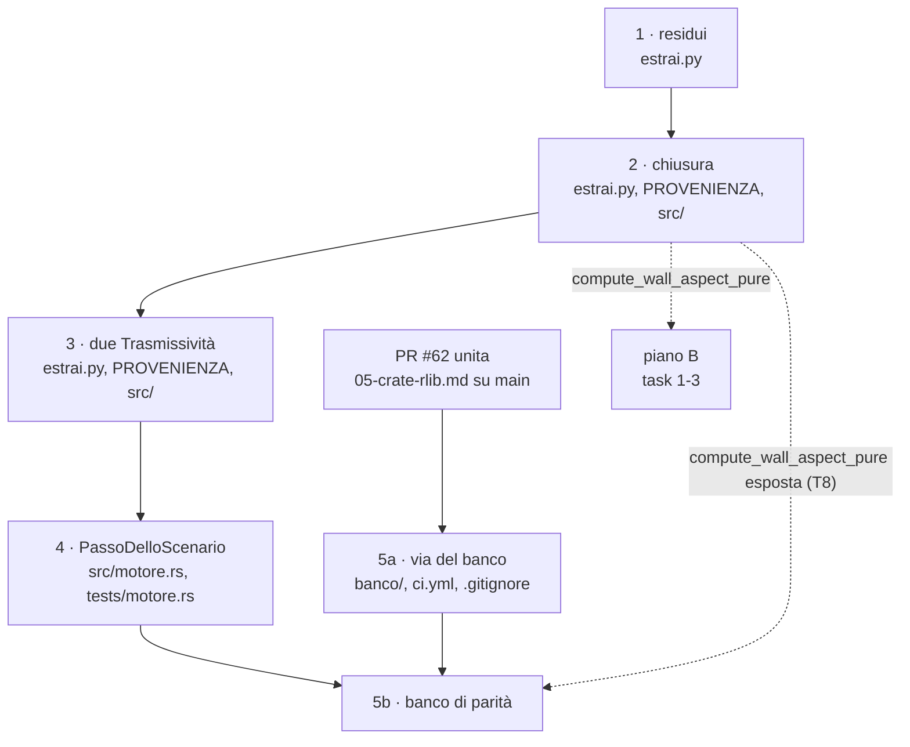

# Piano A, il passo vendorato: annotazione di dispatch

> **Stato, 2026-11-23.** I difetti elencati qui sono stati integrati nei piani, insieme alle decisioni di Mario dello stesso giorno (vedi l'indice). I numeri di riga dei piani citati in questo file si riferiscono alla prima versione, del 2026-11-22: per i difetti fa fede il piano. Restano validi l'assegnazione, l'ordine, i revisori e i riferimenti per task.

Compagno di [`2026-11-22-catena-radiativa-a-passo.md`](2026-11-22-catena-radiativa-a-passo.md). Il piano dice **cosa** si costruisce. Questo documento dice **chi** lo costruisce, in che ordine, con quali obblighi, chi rivede, e **dove il piano è sbagliato** prima che qualcuno lo esegua alla lettera. Non modifica nessuno step del piano: quando un difetto della sezione 4 contraddice uno step, vale la correzione scritta qui, e la decisione finale resta al controllore.

**Provenienza.** Scritto da `/Users/mario/GitHub/OMBRA`, branch `main`, HEAD `d89b78f`. Letti in sessione: il piano e l'indice (Global Constraints), la spec alle righe 152-224 e 419-438, ADR 0004 e 0006, `src/motore.rs` intero, `src/derivazione.rs:119-211`, `vendor/solweig/estrai.py` intero, `vendor/solweig/PROVENIENZA.toml`, `vendor/solweig/Cargo.toml`, `.github/workflows/ci.yml`, `.github/workflows/vendor-check.yml`, `docs/ricerca/index.md`, `01-passo-fuso.md`, `03-chiome-riunite.md`, `04-stato-termico.md:49-127`, `research/catena-radiativa.md:1-203`. `docs/ricerca/05-crate-rlib.md` letto dal branch non unito `origin/research/crate-rlib`, HEAD `89b4faa` (PR #62). Monte letto in un clone al pin `41840b74cd7c003f88dbde0c30fff736cb51bd5d`, con `git rev-parse HEAD` verificato. Ogni `percorso:riga` di monte qui sotto è riferito a quel commit.

---

## 1. Il blocco che ogni dispatch porta addosso

Il subagente riceve `CLAUDE.md` del progetto: le sue regole (copia vendorata prodotta da `estrai.py`, `cargo fmt -p ombra`, `git add` con percorsi espliciti, righe da nord, vocabolario, commenti veri al presente) **valgono e non si ripetono qui**. Le Global Constraints dell'indice dei piani si leggono prima del primo task. Il blocco qui sotto contiene solo ciò che nessuno dei due documenti dice, e va **copiato in ogni brief** di questo piano.

1. **Il pin si rilegge, i numeri di riga no.** Le ricerche 01-03 citano monte a commit più vecchi (`docs/ricerca/index.md:13`). Ogni riga di monte che finisce in un commento o in `PROVENIENZA.toml` si rilegge nel clone al pin e si cita al pin.
2. **`cargo` su questa macchina viene da Homebrew** (`/opt/homebrew/bin/cargo`). `~/.cargo/bin` non esiste: l'`export PATH` di `CLAUDE.md` è innocuo e non basta a spiegare un `command not found`. Si verifica con `command -v cargo` prima di cercare altrove.
3. **Il crate di monte si chiama `rustalgos`, non `solweig`** (`rust/Cargo.toml:2`), e accende `gpu` di default (`:26`). Ogni dipendenza dal clone si scrive `rustalgos = { path = "…/rust", default-features = false }`, come in `docs/ricerca/05-crate-rlib.md:31`.
4. **Un thread solo, da entrambi i lati.** Il passo somma in `f32` diciotto azimut con `par_iter().fold().reduce()` (`rust/src/gvf.rs:243-293`), e l'ordine delle somme dipende da quanti thread ha il pool. OMBRA gira in `pool_a_un_thread()` (`src/motore.rs:354`). Ogni chiamata di confronto a monte gira in un `rayon::ThreadPoolBuilder::new().num_threads(1)` costruito apposta, altrimenti la parità bit per bit misura rayon e non ADR 0004.
5. **Cinque ingressi del letterale `TimestepInputs` hanno una trappola che il tipo non confessa:**
   - `buildings` vale **1 sul suolo e 0 sotto un Edificio** (`rust/src/pipeline_inputs.rs:107`), cioè il contrario di ciò che il nome `edifici` suggerisce;
   - `config.max_height` arriva a `calculate_shadows_rust` come rilievo da scalare (`rust/src/pipeline.rs:653-657`). Si passa il rilievo come lo calcola `ombre`, cime delle chiome comprese (`src/motore.rs:74-90`), non il massimo del modello di superficie;
   - `surface.bush` è `Some` di un raster a zero quando ci sono chiome, per la stessa ragione di `src/motore.rs:92-98`;
   - con due Strati di chioma `surface.cdsm` e `surface.tdsm` sono le Chiome riunite (`ChiomeRiunite::da_strati`, `src/derivazione.rs:205`), mai il primo Strato;
   - `weather.patch_option` vale `2`, lo stesso `PATCH_DEL_CIELO` della passata che ha prodotto le matrici (`src/motore.rs:172`).
6. **Senza chioma i campi della vegetazione valgono uno.** Il nucleo li restituisce a zero, come li ha allocati. A monte li mette a uno Python, `pysrc/solweig/models/precomputed.py:143-152`, e OMBRA fa lo stesso (ADR 0006, righe 108-110).
7. **`HumanScalars.height` è l'altezza del baricentro della Postura**: 1,1 m in piedi, 0,75 m seduti (`rust/src/pipeline_scalars.rs:103-105`). Non è la statura.
8. **Lo Stato termico esce dal passo solo in parte.** `TimestepResultRaw` restituisce `timeadd` e i sei raster, non `firstdaytime` né `timestep_dec` (`rust/src/pipeline.rs:249-267`, `docs/ricerca/04-stato-termico.md:53`). La regola giorno e notte che li aggiorna è Python (`pysrc/solweig/computation.py:705-727`), ed è lavoro del piano B.
9. **Il brief non è vangelo, e nemmeno il piano.** La sezione 4 elenca i difetti noti. Un difetto nuovo si riporta invece di aggirarlo.

Ogni brief nomina inoltre `skill-gate`, `caveman` e `ponytail`, e cita la riga di riferimento del proprio task (sezione 2) nella forma che l'hook `dispatch-gate.py` accetta.

---

## 2. Task per task

Obblighi comuni a tutti i task di codice, che il brief nomina: `skill-gate` (il subagente invoca almeno una skill del proprio ruolo prima di chiudere, e la sceglie lui), `ponytail` prima di scrivere, `superpowers:test-driven-development` sugli step rosso-verde, `caveman` sul report. Nessun task è meccanico: lo `skill-gate` è `true` ovunque.

| # | Task | Subagente | Ordine | Revisori, in parallelo |
|---|---|---|---|---|
| 1 | La regola dei residui | `coder` | sequenziale, primo | `code-reviewer`, `test-writer`, `spec-reviewer` |
| 2 | La chiusura del passo fuso | `coder` | sequenziale, dopo 1 | `code-reviewer`, `rust-reviewer` (ristretto), `security-reviewer` (ristretto), `craft-reviewer`, `spec-reviewer` |
| 3 | Le due Trasmissività | `rust-engineer` | sequenziale, dopo 2 | `code-reviewer`, `rust-reviewer`, `craft-reviewer`, `spec-reviewer` |
| 4 | Il passo dell'Ora | `rust-engineer` | sequenziale, dopo 3 | `code-reviewer`, `rust-reviewer`, `test-writer`, `craft-reviewer`, `spec-reviewer` |
| 5a | La via del banco su `ubuntu-latest` (task 5, step 1) | `rust-engineer` | **parallelo**, subito, in un worktree isolato | `code-reviewer`, `security-reviewer` |
| 5b | Il banco di parità (task 5, step 2-5) | `rust-engineer` | sequenziale, dopo 4 e 5a | tutti e sei: `code-reviewer`, `rust-reviewer`, `test-writer`, `security-reviewer`, `craft-reviewer`, `spec-reviewer` |

`norme-reviewer` non entra mai: nessun file di questo piano tocca le NTC.

### Task 1: la regola dei residui guarda gli identificatori

**Subagente:** `coder`. È uno script Python e la sua prova, senza superficie Rust.
**Riferimento:** `docs/ricerca/index.md:7`. La regola sta nel dossier, `research/catena-radiativa.md:117-130`.
**Ordine:** primo. I task 2 e 3 modificano lo stesso `estrai.py`.
**Revisori:** `code-reviewer`. `test-writer`, sulla domanda «la prova fallisce se la regola si rompe?», caso per caso. `spec-reviewer`. `security-reviewer` resta fuori: il lavoro `riproducibile` esegue già lo script della PR con `contents: read` (`vendor-check.yml:37-39`), e il task non cambia quella superficie.
**Casi limite presi dalla storia del repository:** `a1f93b5 fix: the vendor check was crying wolf` è la stessa classe, un controllo che scatta su testo innocuo. La prova del piano copre commento e letterale. Va aggiunto un caso in cui un identificatore Python compare in un `//!` di modulo, come `pipeline_inputs.rs:3-6` e `api.rs:3` al pin: quella riga deve dare zero residui.

### Task 2: la chiusura del passo fuso

**Subagente:** `coder`. Le modifiche sono regole Python e prosa di `PROVENIENZA.toml`, e il compilatore fa da giudice. `rust-engineer` sarebbe sprecato: il task non scrive una riga di Rust.
**Riferimento:** `docs/ricerca/index.md:13`. Chiusura e trasformazioni stanno nel dossier, `docs/ricerca/index.md:7`, `research/catena-radiativa.md:48` e `:89`, con la trappola di T5 a `:111`.
**Ordine:** dopo il task 1.
**Revisori:** `code-reviewer` sulle regole. `rust-reviewer` **ristretto a una domanda**: il diff fra `vendor/solweig/src` e i file del clone si spiega tutto con le regole dichiarate? Lo stile del codice di monte non si rivede, perché non è nostro. `security-reviewer` **ristretto alla catena di fornitura**: circa settemila righe di terzi entrano nel binario, quindi si controlla che non entrino dipendenze, `build.rs` o `unsafe` nuovi, e che `allow_threads_unchecked` sia davvero uscito. `craft-reviewer` sulla prosa di `PROVENIENZA.toml` e sul messaggio di commit, che deve elencare la chiusura. `spec-reviewer`.
**Casi limite presi dalla storia:** `006cc97 fix: the vendored kernel was unusable from outside its own crate`. Una `pub(crate)` dimenticata compila dentro la copia e fallisce dal crate esterno. La prova di raggiungibilità si fa da `ombra`, non da un test interno a `vendor/` (`PROVENIENZA.toml:211-215`).

### Task 3: le due Trasmissività al posto di `psi`

**Subagente:** `rust-engineer`. Lo script è Python, ma il testo che inserisce è Rust: un campo con il suo lifetime in `TimestepInputs<'a>`, due firme che passano da `f32` ad `ArrayView2<f32>`, e la lettura per cella dentro un ciclo parallelo. Sbagliare quel testo è l'errore che ADR 0004 esiste per prevenire.
**Riferimento:** `docs/ricerca/01-passo-fuso.md:34`.
**Ordine:** dopo il task 2. Stessi file.
**Revisori:** `rust-reviewer` sulle undici righe e sui due campi, con una domanda precisa: dove il corpo legge `psi` dentro un ciclo, legge `psi[[r, c]]` della cella corrente (`pipeline_radiation.rs:388-391` e `:410-411`, `vegetation.rs:405-406`)? `code-reviewer`. `craft-reviewer` sulla sezione nuova di `PROVENIENZA.toml`. `spec-reviewer`.

### Task 4: il passo dell'Ora nel Motore

**Subagente:** `rust-engineer`.
**Riferimento:** `docs/ricerca/03-chiome-riunite.md:18`. Vanno citati anche `docs/ricerca/04-stato-termico.md:53`, per i campi dello Stato termico che il passo non restituisce, e `docs/ricerca/01-passo-fuso.md:112`, per i nomi `svf_aveg*`. Il piano non cita nessuna delle due righe.
**Ordine:** dopo il task 3. Consuma l'API dei task 2 e 3.
**Revisori:** tutti e cinque. `test-writer` deve rispondere a una domanda: il test sul piano aperto fallisce se i campi della vegetazione restano a zero? Vedi il difetto D10.
**Casi limite presi dalla storia:** `93ffa15 fix: the coverage rule was a cell off, and the grid step was never checked`, per il controllo delle forme. `2ada596 fix(motore)!: count once the sky two canopy layers cover`, per la `detrazione` con due Strati: si ricava per differenza fra i tre campi come in `src/motore.rs:280-301`, mai come somma per Strato.

### Task 5a: la via del banco, misurata su `ubuntu-latest`

È lo step 1 del task 5, staccato. Non dipende da niente dei task 1-4: un test vuoto, il clone al pin e una riga di `sed` sul suo manifesto. Se nessuna delle due vie collega, il banco intero torna a Mario, ed è meglio saperlo prima di aver scritto i task 2-4.
**Subagente:** `rust-engineer`.
**Riferimento:** `docs/ricerca/05-crate-rlib.md:341`. La riga esiste solo dopo l'unione della PR #62. Prima di allora il brief cita il file sul branch `research/crate-rlib`.
**Ordine:** parallelo ai task 1-4, in un worktree isolato su un branch suo. Tocca `banco/`, `.gitignore` e `.github/workflows/ci.yml`, che nessun altro task tocca.
**Precondizione:** il sì di Mario a spingere un branch su GitHub per far girare il lavoro (sezione 5).
**Revisori:** `security-reviewer` sul lavoro di CI, che clona un repository esterno, ne modifica il manifesto e compila con Python: permessi `contents: read`, nessun segreto nell'ambiente. `code-reviewer`.
**Casi limite presi dalla storia:** `af47339 fix: a global RUSTFLAGS made other people's warnings our errors`. La via B1 di `05-crate-rlib.md` passa da `RUSTFLAGS`, e se mai la si usasse va limitata al passo del banco.

### Task 5b: il banco di parità

**Subagente:** `rust-engineer`.
**Riferimento:** `docs/ricerca/05-crate-rlib.md:29` per il manifesto, `docs/ricerca/01-passo-fuso.md:34` per il caso dello scambio, `docs/ricerca/04-stato-termico.md:62` per il passaggio dello Stato termico da un'Ora all'altra.
**Ordine:** dopo il task 4 e il 5a.
**Revisori:** tutti e sei. `test-writer` risponde caso per caso alla domanda «quale errore del task 3 farebbe fallire questo test?», con i difetti D2, D3 e D5 come elenco di partenza.

---

## 3. Il grafo delle dipendenze vere

**Dipendenze che il piano non dichiara.**

- **Il task 5b dipende dal task 2, non solo dal 4.** Il piano fa ricavare i Muri del banco a `compute_wall_aspect_pure` «del clone» (riga 272 del piano), che dal clone non si raggiunge (difetto D6). Si raggiunge la copia vendorata, e solo dopo la regola del task 2 che la espone.
- **Il task 5a non dipende da niente del piano A**, mentre il piano lo mette per ultimo. Dipende dalla PR #62 per il riferimento, e dal sì di Mario per il push.
- **Il passo del banco dipende da due scelte del task 4**: il pool a un thread e la cache della geometria. Il lato di monte del banco deve fare le stesse due scelte (blocco, punto 4; difetto D8), altrimenti un confronto bit per bit fallisce per ragioni estranee ad ADR 0004.

**Cosa resta sequenziale, e perché.** I task 1, 2 e 3 riscrivono `estrai.py` e `PROVENIENZA.toml`. Il task 4 compila solo con l'API dei task 2 e 3. Il task 5b chiama il task 4.

---

## 4. Difetti del piano

In ordine di gravità. «Piano:N» è la riga di `2026-11-22-catena-radiativa-a-passo.md`.

### Alta

**D1. La dipendenza del banco non si risolve, e accenderebbe la GPU.** Piano:259 dichiara `solweig = { path = "monte/rust" }` e piano:264 usa `solweig::api::compute_timestep_rust`. Il pacchetto si chiama `rustalgos` (`rust/Cargo.toml:2`), quindi cargo non trova `solweig` in quel percorso. E `default = ["gpu"]` (`:26`) porterebbe `wgpu` nel banco e farebbe girare il passo sulla GPU dove ce n'è una: su arm64 Metal, e la parità bit per bit con il percorso CPU di OMBRA cade. **Correzione:** `rustalgos = { path = "monte/rust", default-features = false }`, percorsi `rustalgos::api::…`, come nel crate di prova di `docs/ricerca/05-crate-rlib.md:29-35`.

**D2. Nessun test vede la lettura alla prima cella.** Il Review Focus 2 (piano:20) promette che il secondo caso del banco (piano:275) usa «raggio e cielo diversi per questo». Ma quel caso usa due raster **costanti**, e su un raster costante `psi[[0, 0]]` e `psi[[r, c]]` hanno lo stesso valore. L'errore che il punto 2 nomina resta invisibile, ed è proprio quello per cui ADR 0004 esiste. La sola prova che il nucleo legge cella per cella è una misura a mano (ADR 0004, righe 155-157). **Correzione:** un terzo caso con i due raster divisi a metà, 0,03 a sinistra e 0,5 a destra. L'oracolo è esatto: la metà sinistra uguale bit per bit a monte con `psi = 0.03`, la destra a monte con `psi = 0.5`, per le sei uscite. È la forma che la misura di ADR 0004 ha già visto tenere sulla metà rimasta costante.

**D3. Il caso dello scambio vede solo il lato del raggio, e di notte fallisce senza motivo.** `shadow` legge la trasmissività in un punto solo, l'espressione lungo il raggio (`rust/src/pipeline.rs:679`). Un errore che lega anche il cielo a `trasmissivita_raggio_v`, o che non legge mai `trasmissivita_cielo_v`, passa il caso di piano:275 identico. Inoltre «diversa da quella con `psi = 0.03`», asserita Ora per Ora, è falsa nelle Ore dopo il tramonto. A 12,55 E con fuso +1 il sole tramonta verso le 19:50, e dalle 20 alle 22 `shadow` non dipende da nessuna trasmissività. **Correzione:** «diversa» si asserisce su almeno un'Ora di giorno, e si aggiunge una seconda asserzione: in quel caso `kdown` differisce da monte con `psi = 0.5` in almeno una cella sotto la chioma, perché il cielo anisotropo legge la trasmissività verso il cielo patch per patch (`pipeline_radiation.rs:403`).

**D4. Il confronto misura rayon.** Il lato OMBRA gira in un pool a un thread (`src/motore.rs:354-361`, piano:241). Il lato di monte, così com'è scritto, gira nel pool globale. La riduzione di `gvf.rs:243-293` somma in `f32` diciotto azimut raggruppati dal pool, e con un numero diverso di thread i raggruppamenti cambiano. `05-crate-rlib.md:216-217` ha misurato la ripetibilità su sei core, non l'uguaglianza fra uno e sei, e su un ingresso senza muri né cache. **Correzione:** blocco, punto 4.

**D5. Due campi dello Stato termico non escono dal passo.** Piano:203 fa restituire a `ora` un `StatoTermico` intero, e piano:274 confronta `firstdaytime` dopo la sesta Ora. Ma `TimestepResultRaw` non ha né `firstdaytime` né `timestep_dec` (`rust/src/pipeline.rs:249-267`). OMBRA dovrebbe copiarli dall'ingresso, e il confronto su `firstdaytime` confronterebbe la stessa copia sui due lati: un test che non può fallire. Il passaggio «copiando l'uscita nell'ingresso» (piano:272) non è nemmeno ciò che fa monte, che di notte rimette `firstdaytime = 1` e `timeadd = 0` (`computation.py:723-727`). Per la parità va bene, perché i due lati fanno lo stesso, ma non è un modello da riusare nel piano C. **Correzione:** `UscitaDellOra` porta `timeadd` e i sei raster, cioè ciò che il passo restituisce. `firstdaytime` e `timestep_dec` restano al chiamante, che il piano B scrive portando `computation.py:705-727`. Dal confronto del banco esce `firstdaytime`.

### Media

**D6. `compute_wall_aspect_pure` non si raggiunge dal clone, e `DA_ESPORRE` non la può esporre.** Piano:272 la chiede «del clone»: è `pub(crate)` (`wall_aspect.rs:146`), il modulo è privato (`lib.rs:28`), e `api.rs:17-28` non la riesporta. Piano:105 la fa esporre con `DA_ESPORRE` (T8), ma `esponi()` cerca righe che *cominciano* con la dichiarazione e vi antepone `pub ` (`estrai.py:218-222`). Su `pub(crate) fn …` le strade sono due, e sbagliano entrambe: zero promozioni, e lo script si ferma, oppure `pub pub(crate) fn`, che non compila. **Correzione:** una regola sua, a conteggio 1, che riscrive `pub(crate) fn compute_wall_aspect_pure` in `pub fn compute_wall_aspect_pure`. Il banco usa la copia vendorata. Per il confronto basta, perché i Muri sono un ingresso uguale sui due lati.

**D7. Lo step 1 del task 2 non arriva al compilatore.** Piano:89 dice di aggiungere i file a `FILE` senza regole, lanciare lo script, poi `cargo build`. Lo script si ferma prima: `DA_ESPORRE[nome]` e gli altri dizionari sono indicizzati per file (`estrai.py:239-242`, `KeyError` sul primo file nuovo), e il controllo dei residui esce senza scrivere niente (`:245-252`). Ma la chiusura al pin si legge già: `lib.rs:3-28` dichiara 25 moduli, e se ne tolgono `gpu`, `morphology`, `pet` e `pipeline_bundles`. Il solo riferimento a `pipeline_bundles` sta in `pipeline.rs:508`, e nessun file nomina `morphology` o `pet` fuori da `lib.rs` (grep sul clone). Restano **21 file**, cioè i 17 del dossier più `pipeline_inputs.rs`, `api.rs`, `skyview.rs` e `utci.rs`. Il conteggio di piano:89 torna. **Correzione:** `FILE` riceve subito quei 21, con una voce vuota per file in ogni dizionario, e il compilatore conferma invece di scoprire.

**D8. `first_ht` e `second_ht` non stanno in un chiamante Python.** Piano:241 li fa ricavare «dall'altezza della persona come fa lo strato di monte», rileggendo «il chiamante Python di `precompute_gvf_geometry_cpu`». Python chiama un'altra funzione, `pipeline.precompute_gvf_cache(…, human.posture_height, …)` (`computation.py:463-490`, `:836-843`). La derivazione sta in Rust, dentro quella `#[pyfunction]`: `first_ht = human_height.round().max(1.0)` e `second_ht = human_height * 20.0` (`pipeline.rs:415-416`). L'estrazione toglie quella funzione, quindi OMBRA la porta e cita `solweig@41840b7 rust/src/pipeline.rs:415-416`. L'altezza in ingresso è quella della Postura (blocco, punto 7). Si porta quella e non la formula di `timestep_physics` (`pipeline.rs:1111-1119`), che arrotonda in un altro modo e serve un altro scopo. **Limite dichiarato:** il banco costruisce la cache di monte con la stessa formula scritta nel test, quindi un errore di trascrizione sarebbe identico sui due lati. Il banco verifica il passo, non questa derivazione, che si verifica in revisione contro le due righe.

**D9. `Direzionali` duplica un raster che `Cielo` ha già.** Il commento di piano:177-178 mette `svfbuveg` fra i direzionali. Ma `svfbuveg` è `SkyViewFactor::con_le_chiome` (`src/motore.rs:163`, «`svfbuveg` upstream»), che `Cielo` porta già: due sorgenti per un raster. Inoltre «named as upstream» lascia aperto quale monte: `SvfIntermediate` dice `svf_veg_blocks_bldg_sh*` (`vendor/solweig/src/skyview.rs:223-227`), `SvfViews` dice `svf_aveg*` (`pipeline_inputs.rs:41-45`). **Correzione:** `svfbuveg` esce da `Direzionali`, e il letterale passa `con_le_chiome`. I campi prendono i nomi di `SvfViews`, perché è lì che finiscono, con la corrispondenza citata da `docs/ricerca/01-passo-fuso.md:112`. Con due Strati i direzionali vengono dalla passata sulle Chiome riunite, come le matrici.

**D10. Senza chioma, i campi della vegetazione restano a zero.** Il piano non dice che `cielo` li porta a uno quando non c'è chioma (blocco, punto 6). Il test `il_passo_su_un_piano_aperto_e_finito` (piano:232) gira proprio senza chioma: con i campi a zero il passo riceverebbe un cielo coperto tutto dalla vegetazione, e il test passerebbe lo stesso se i valori restano entro i suoi margini larghi. In quel caso `volta_coperta` e `detrazione` valgono zero. **Correzione:** il test asserisce anche che, senza chioma, i dieci campi della vegetazione di `Cielo` valgono uno.

**D11. Gli ingressi del letterale che il piano non nomina.** Piano:241 elenca `ground_scheme`, `lc_grid`, `output_mask` e `gvf_cache`. Tace su `buildings`, `max_height`, `bush`, `cdsm` e `tdsm` con due Strati, e `patch_option`. Ognuno ha la sua trappola (blocco, punto 5). Il campo `edifici` di `IngressiDelloScenario` (piano:208) va documentato con il verso di monte, oppure rinominato da chi lo costruisce: decide il piano B, che produce la maschera.

### Bassa

**D12. Quattro step condizionali si decidono già.** T7 non serve: i campi di `TimestepResultRaw` sono `pub` al pin (`pipeline.rs:249-267`). T4 serve, perché `unsafe fn allow_threads_unchecked` c'è (`pipeline.rs:287`) e così `impl Default for WallAspectRunner` (`wall_aspect.rs:405`), entrambi in colonna zero. T5 serve (`pipeline.rs:508-511`). Di T8 resta solo `compute_wall_aspect_pure` (D6), perché `GvfGeometryCache` e `precompute_gvf_geometry_cpu` sono già `pub` e riesportate (`api.rs:17`, `gvf_geometry.rs:270`). Anche «`vendor-check.yml` se elenca i file» (piano:81) non ha seguito: il lavoro confronta l'intera cartella (`vendor-check.yml:56`).

**D13. Il grep del task 3 si aspetta righe che non ci sono.** Piano:148 si aspetta righe dentro `#[cfg(feature = "gpu")]`. Al pin `weather.psi` compare solo a `pipeline.rs:679`, `:761` e `:1318`. La chiamata GPU legge la legatura locale `psi` (`:1509`), non il campo. Dopo la sostituzione il grep restituisce zero righe. Il controllo è anche ridondante: tolto il campo da `WeatherScalars`, una lettura dimenticata non compila.

**D14. La prova della regola dei campi ha la forma sbagliata.** Piano:134 la costruisce su un campo con il suo commento `///`. Al pin `psi` e `conifer` non hanno commento: hanno `#[pyo3(get, set)]` (`pipeline_scalars.rs:42-43`, `:151-152`), che T2 toglie. La prova va costruita sulla forma reale. La regola dei campi gira dopo T2, e il conteggio si legge da quel giro.

**D15. Il controllo «senza clone» non può scattare, e il rischio vero sta altrove.** Piano:284: senza `banco/monte/rust/Cargo.toml` la dipendenza di percorso non si risolve e cargo fallisce comunque. Il verde senza confronto nasce invece da un confronto vuoto: `None == None` su un'uscita non chiesta, zero Ore, zero celle. **Correzione:** il banco asserisce che le sei uscite sono `Some` e che l'ingresso non è banale. Tmrt deve variare fra le celle, come nella prova di `05-crate-rlib.md:217-218`, e `shadow` deve avere sia celle a 0 sia celle a 1.

**D16. La prova di `estrai.py` non gira in CI.** Il task 1 la crea, ma `vendor-check.yml:43-61` lancia solo l'estrazione. Una prova che nessuno esegue invecchia senza segnale. **Correzione:** un passo `python3 -I vendor/solweig/estrai.py --prova` nel lavoro `riproducibile`.

**D17. `banco/Cargo.lock` manca dal commit.** Piano:289 non lo aggiunge. La prova di `05-crate-rlib.md:37-40` partiva dal lock di monte, così che `pyo3` e `numpy` restassero alle versioni del pin. Senza lock, la CI risolve versioni nuove a ogni giro.

**D18. Un nome sbagliato e una citazione mancante.** Il lavoro di `ci.yml` si chiama `verifica` (`ci.yml:16`), non `test` (piano:284). «I valori della classe 1 di monte» (piano:272) vanno citati al pin, per la regola «nessun identificativo inventato».

### I nomi che il task 4 propone

- **`Cielo`**: confermato. Porta ciò che la passata sulla volta celeste produce, e non collide con «Modello di cielo» di `CONTEXT.md`, che è una scelta dell'utente e non un risultato.
- **`detrazione`**: confermato. È lo stesso significato della funzione privata `detrazione` di `src/motore.rs:320-329`, «the sky one canopy layer takes away», esteso a due Strati con la formula di `:292-299`. Il commento dice se il valore è preso prima o dopo il limite a `[0, 1]` che `con_le_chiome` subisce (`:267`, `:300`).
- **`volta_coperta`**: confermato. Ricalca `CONTEXT.md:70`, «dove una chioma copre la volta celeste». Vale `1 − svf_veg` della passata sulle Chiome riunite, e zero senza chioma.
- **`Direzionali`**: confermato, con D9. Il nome è un po' largo, perché contiene anche `svf_veg` e `svf_aveg`, che direzionali non sono, e il commento lo dice.
- **`MatriciDOmbra`**: confermato. Si rinominano due campi, perché ADR 0006 (righe 22-23) le chiama «edifici, vegetazione e chiome davanti agli edifici»: `edifici`, `chiome`, `chiome_davanti_agli_edifici`, nell'ordine `shmat`, `vegshmat`, `vbshmat`. La forma impacchettata del piano, `(righe, colonne, 20)`, è giusta: un bit per patch, `pack_bytes` a `vendor/solweig/src/skyview.rs:267`, e la convenzione dei bit in `pipeline_inputs.rs:8-10`.

### Note per la revisione trasversale, fuori dal piano A

- La spec (riga 218) ottiene la Trasmissività verso il cielo «dividendo la detrazione per la volta». Quel rapporto vale `1 − T`, non `T`: `CONTEXT.md:78` la definisce come la media di ciò che passa. Il conto spetta al piano B, task 5.
- Il passo calcola le ombre con un'altezza minima del sole fissata a 3° (`pipeline.rs:671`), `ombre` con 2° (`src/motore.rs:41`). Fra 2° e 3° l'`ombra` del passo e quella di `motore::ombre` divergono. La scelta spetta al piano C.

---

## 5. Decisioni che spettano a Mario

- Il permesso di spingere un branch su GitHub per misurare la via del banco su `ubuntu-latest` (task 5a).
- L'unione della PR #62 prima del task 5a, perché il suo riferimento esista su `main`.
- Quando gira il lavoro `parita`: a ogni PR, oppure solo quando cambiano `vendor/solweig/**`, `src/motore.rs` o `banco/**`. Compila `pyo3` e il crate di monte, e costa minuti a ogni giro.
- Se nessuna delle due vie, A2 e B2, collega su Linux: il banco esce dalla CI e resta locale, oppure il piano A si ferma.

Le altre scelte di strumento (forma di `UscitaDellOra`, terzo caso del banco, `Cargo.lock` del banco, nomi delle matrici) le prende questo documento, sopra, e il controllore le può rovesciare.
