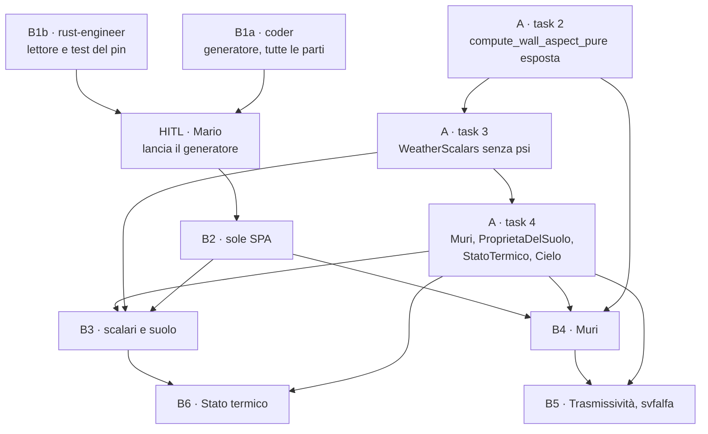

# Piano B, lo strato portato — annotazione di dispatch

> **Stato, 2026-11-23.** I difetti elencati qui sono stati integrati nei piani, insieme alle decisioni di Mario dello stesso giorno (vedi l'indice). I numeri di riga dei piani citati in questo file si riferiscono alla prima versione, del 2026-11-22: per i difetti fa fede il piano. Restano validi l'assegnazione, l'ordine, i revisori e i riferimenti per task.

Compagno di [`2026-11-22-catena-radiativa-b-strato.md`](2026-11-22-catena-radiativa-b-strato.md). Il piano dice **cosa** si costruisce; questo documento dice **chi** lo costruisce, **in che ordine**, **con quali skill**, **chi rivede**, e alla sezione 5 **dove il piano è sbagliato**. Non modifica il piano: dove la sezione 5 corregge uno step, la correzione vale sul testo del piano e il brief di dispatch la copia.

Provenienza: scritto da `/Users/mario/GitHub/OMBRA`, branch `main`, HEAD `d89b78f`. Letti in sessione: il piano B, l'indice dei piani, il task 2-4 del piano A, la spec (righe 180-290, 436-500), `src/sole.rs`, `src/corsa.rs:295-560`, `src/motore.rs:19-41`, `:55-340`, `src/derivazione.rs:20-40`, `:110-135`, `src/meteo.rs:25-116`, `:437-464`, `:615-640`, `src/dominio.rs:182-194`, `Cargo.toml`, `.github/workflows/ci.yml:32-43`, `docs/ricerca/index.md`, le ricerche 01-04 nelle righe citate, e `docs/ricerca/04-strato-python-monte.md` dal branch non unito `origin/research/strato-python-monte` (`git show`). Monte letto in un clone al pin `41840b74cd7c003f88dbde0c30fff736cb51bd5d` (tag `v0.1.0b101`, verificato con `git log -1` e `git tag --points-at HEAD`). Nel testo, `S:` precede un percorso di quel clone.

---

## 1. Il blocco che ogni dispatch porta addosso

Un subagente non eredita niente. Le righe qui sotto vanno **copiate in ogni prompt di dispatch** di questo piano, qualunque sia il task.

1. **Tre parole obbligatorie nel brief: `skill-gate`, `caveman`, `ponytail`.** `skill-gate`: invoca almeno una skill del tuo roster prima di chiudere il task. `caveman`: il report che restituisci è compresso. `ponytail`: la modifica più piccola che risolve tutto il task, callers e test compresi. L'hook `dispatch-gate.py` nega il brief che non le nomina.
2. **Riferimento alla ricerca.** Ogni brief porta la riga `docs/ricerca/<file>.md:<riga>` della sezione 4 per il suo task, oppure la riga elenco esatta `- nessun riferimento pertinente`. E ogni affermazione sul codice esistente cita un `file:riga` letto nella sessione che scrive il brief.
3. **Comandi.** `export PATH=$HOME/.cargo/bin:$PATH` prima di `cargo`. Il cancello di CI è `cargo fmt -p ombra --check`, `cargo clippy -p ombra --all-targets --all-features -- -D warnings`, `cargo test -p ombra --all-features` (`.github/workflows/ci.yml:32-43`). Mai `cargo fmt --all`: entra in `vendor/solweig/`.
4. **`vendor/solweig/src` non si tocca**: è prodotto di `estrai.py`, e il lavoro `Vendor check` lo riconfronta byte per byte. Se un task di questo piano sembra chiedere una modifica lì, fermati e riporta: è lavoro del piano A.
5. **Ogni costante e formula portata cita la riga di monte al pin**, nella forma `// solweig@41840b7 pysrc/solweig/physics/wallalgorithms.py:44`. Le righe si rileggono nel clone, mai si copiano da una ricerca: le ricerche 01-03 citano altri commit (`docs/ricerca/index.md:13`). Clone già pronto, sola lettura: `/private/tmp/claude-501/-Users-mario--claude-spares-spare-m9JWjO/3691481a-c850-4bf2-8c15-b19c42bc0f66/scratchpad/monte`. Se manca, rifallo fuori dal repository con `git clone --filter=blob:none https://github.com/UMEP-dev/solweig <dir>` e `git -C <dir> checkout 41840b74cd7c003f88dbde0c30fff736cb51bd5d`.
6. **I record di monte li genera solo Mario.** Il generatore non entra in CI e non lo lancia un agente. Un implementatore che trova un record mancante o un caso che il record non copre si ferma e lo riporta. Un file in `tests/record/` non si scrive e non si corregge a mano.
7. **Rosso per il motivo giusto.** Ogni test nuovo fallisce prima della riga di produzione, e fallisce per l'assenza della funzione o per lo scarto dal record, non per un errore di setup. Una tolleranza si allenta solo con la misura scritta accanto.
8. **Le righe dei raster corrono da nord**: riga 0 è la più settentrionale.
9. **Vocabolario di `CONTEXT.md`** nei nomi: Ora, Corsa, Giornale, Muro, Stato termico, Trasmissività lungo il raggio, Trasmissività verso il cielo, Chiome riunite, Strato di chioma. «Sky view factor» resta il nome dei due valori pubblicati. Codice, commenti e commit in inglese.
10. **Un commento descrive il codice che c'è adesso.** Ciò che verrà si scrive al futuro e dice che verrà.
11. **`git add` con percorsi espliciti**, mai `-A` né `.`: un altro agente può star scrivendo nell'albero.
12. **Il piano non è vangelo.** La sezione 5 di questo documento elenca i difetti già trovati, e il brief copia la correzione che riguarda il task. Un difetto nuovo si riporta invece di aggirarlo: la decisione resta a chi dispaccia.

---

## 2. Il grafo delle dipendenze vere

Il piano dichiara che «i task 1, 2 e 3 non toccano il Motore e possono partire prima che A sia unito» (piano `:13`, indice `:15`). Per il task 3 è falso: consuma `motore::{WeatherScalars, ProprietaDelSuolo}` (piano `:116`), che nascono nel task 4 di A, e `WeatherScalars` senza `psi`, che nasce nel task 3 di A. Prima di A partono solo i task 1 e 2.

**Perché queste frecce.**

- **B1a e B1b in parallelo.** Toccano file disgiunti (`strumenti/record/` contro `tests/record.rs` e `tests/comune/`) e si incontrano solo nel formato del record, che il piano fissa a `:35-37`. Il generatore scrive **tutte e sei le parti** in un dispatch solo (difetto D14): Mario lo lancia una volta, invece di cinque.
- **B2 prima di B3 e di B4.** B3 consuma `sole::{posizione, altezza_massima_del_giorno}`; B4 e B5 toccano `tests/motore.rs`, che B2 deve già aver riallineato alla firma nuova di `posizione` (sei chiamate, `tests/motore.rs:49`, `:89`, `:110`, `:118`, `:130`, `:138`).
- **B4 e B5 in sequenza.** Entrambi modificano `src/motore.rs` e `tests/motore.rs`.
- **B3 prima di B6.** Entrambi aggiungono un modulo a `src/lib.rs`. Il conflitto è di una riga, ma la regola è meccanica: stesso file, sequenza.
- **Le due catene dopo A4 sono disgiunte**: {B3, poi B6} tocca `src/scalari.rs`, `src/suolo.rs`, `src/meteo.rs`, `src/stato_termico.rs`, `src/lib.rs`; {B4, poi B5} tocca `src/motore.rs`, `src/derivazione.rs`. In parallelo solo con due worktree distinti. Con `superpowers:subagent-driven-development`, che tiene un implementatore alla volta, l'ordine è B1 → B2 → B3 → B6 → B4 → B5.
- **Prima che A sia unito**: B1 e B2 per intero. Il resto può partire da un branch impilato su `feat/passo-vendorato` appena il task 4 di A è committato, senza aspettare l'unione; la PR di B si apre dopo.

---

## 3. Assegnazioni in breve

| # | Task | Subagente | Skill-gate | Ordine | HITL di Mario | Revisori, in parallelo |
|---|---|---|---|---|---|---|
| B1a | Generatore dei record, `requisiti.txt`, `LEGGIMI.md` | `coder` | true | parallelo a B1b, primo | lancia `genera.py tutto` | `code-reviewer`, `craft-reviewer`, `security-reviewer`, `spec-reviewer` |
| B1b | Lettore dei record e test del pin | `rust-engineer` | true | parallelo a B1a, primo | — | `code-reviewer`, `rust-reviewer`, `test-writer`, `spec-reviewer` |
| B2 | Il sole è l'SPA di monte | `rust-engineer` | true | dopo il record `sole` | — | `code-reviewer`, `rust-reviewer`, `test-writer`, `craft-reviewer`, `spec-reviewer` |
| B3 | Scalari dell'Ora e suolo | `rust-engineer` | true | dopo B2, A3, A4 | — | `code-reviewer`, `rust-reviewer`, `test-writer`, `craft-reviewer`, `spec-reviewer` |
| B4 | I Muri | `rust-engineer` | true | dopo B2, A2, A4 | — | `code-reviewer`, `rust-reviewer`, `test-writer`, `spec-reviewer` |
| B5 | Le due Trasmissività e `svfalfa` | `rust-engineer` | true | dopo B4 | — | `code-reviewer`, `rust-reviewer`, `test-writer`, `spec-reviewer` |
| B6 | Lo Stato termico | `rust-engineer` | true | dopo B3 | — | `code-reviewer`, `rust-reviewer`, `test-writer`, `spec-reviewer` |

Nessuno step è banale: skill-gate true ovunque. `norme-reviewer` non entra: nessun file del piano si dichiara fonte di verità normativa NTC, e le costanti citano righe di monte, non articoli. `security-reviewer` entra solo in B1a, per la catena di fornitura del generatore (pacchetti da PyPI, un interprete che legge e scrive nel repository). I revisori sono in sola lettura e indipendenti: si dispacciano insieme, e i findings di `spec-reviewer` restano in un report separato.

---

## 4. Task per task

### B1a — Il generatore (`coder`)

- **Riferimento**: `docs/ricerca/04-stato-termico.md:298` (la wheel `solweig==0.1.0b101` con cui sono state fatte le misure). La ricerca sullo strato, `04-strato-python-monte.md:444` (§5: eseguire monte da un agente è stato negato, e da qui viene l'HITL), sta sul branch non unito: vedi la decisione 5 della sezione 7.
- **Correzioni che il brief copia**: D14, D15, D16, D17, D21. Tutte e sei le parti in questo dispatch, con i casi elencati nei task 2-6 del piano e quelli aggiunti dalla sezione 5 (ora 24, quota diversa da zero, alba con DNI e DHI misurate, indice infinito, Muro sui due lati della fascia di bordo).
- **Come il generatore chiama monte**, una funzione di monte per parte, mai una riscrittura delle sue righe dove la funzione esiste:
  - `sole`: `physics.sun_position.sun_position` sul dizionario di `Location.to_sun_position_dict()` (`S:pysrc/solweig/models/location.py:225-231`); `altmax` dal ciclo di `S:pysrc/solweig/timeseries.py:89-124`.
  - `scalari`: oggetti `Weather` costruiti come `Weather.from_epw` li costruisce (`S:pysrc/solweig/models/weather.py:484-496`, ramo con radiazione misurata), poi `timeseries._precompute_weather` (`S:pysrc/solweig/timeseries.py:64-143`). `dectime`, `snup`, `rad_g0`, `zen_deg`, `jday` sono variabili locali di `calculate_core_fused` (`S:pysrc/solweig/computation.py:337-363`, `:384-385`): il generatore chiama `daylen`, `clearnessindex_2013b` e `diffusefraction` con gli argomenti di quelle righe e le cita una per una. È l'unica parte in cui il record ricompone righe di monte invece di chiamare una funzione intera, e il `LEGGIMI.md` lo dichiara.
  - `suolo`: `SurfaceData.get_land_cover_properties` su una griglia con le classi 0, 1, 2, 5, 6, 7 (`S:pysrc/solweig/models/surface.py:1913-1986`).
  - `muri`: `findwalls(dsm_f32, 1.0)` e `filter1Goodwin_as_aspect_v3(walls, 1.0 / pixel_size, dsm_f32)`, come `S:pysrc/solweig/models/surface.py:1163-1165`.
  - `svfalfa`: `components.svf_resolution.resolve_svf` su un oggetto che porta `svf` come `SvfArrays` (`S:pysrc/solweig/models/precomputed.py:29`), non le tre righe ricopiate.
  - `stato`: solo `ThermalState.initial` (`S:pysrc/solweig/models/state.py:61-83`); niente «stato dopo il passo» (D21).
- **Completamento**: `genera.py tutto` scrive un record per parte, ogni record porta `pin`, `wheel`, `comando`, e gli ingressi accanto alle uscite, con i float scritti in forma che si rilegge identica (`repr`) e `inf` dove monte dà infinito. Il generatore gira con `python3 -I`.
- **HITL**: Mario crea l'ambiente e lancia `genera.py tutto` da un terminale. Il comando esatto lo scrive il `LEGGIMI.md` (D15).

### B1b — Il lettore e il test del pin (`rust-engineer`)

- **Riferimento**: `- nessun riferimento pertinente` (il formato del record è deciso nel piano, `:35-37`, non in una ricerca).
- **Correzioni**: D22.
- **Completamento**: `cargo test -p ombra --test record` è rosso con «nessun record» sulla cartella vuota, e verde dopo l'HITL su tutti i record. Il pin si legge da `motore::versione().commit` (`src/motore.rs:29-31`), mai scritto nel test.
- **Commit**: dopo l'HITL, insieme a B1a, con i record. Un commit con il test del pin e senza record lascerebbe la CI rossa.

### B2 — Il sole (`rust-engineer`)

- **Riferimento**: `docs/ricerca/02-sole-meta-passo.md:27` (convenzione di monte: sole a etichetta meno mezzo passo), `docs/ricerca/02-sole-meta-passo.md:105` (lo scarto di 0,47° dal NOAA, il rosso atteso).
- **Correzioni**: D9, D10, D11, D12, D25.
- **Casi degeneri misurati altrove in questo progetto**: l'ora locale oltre 24 (`src/corsa.rs:420-422`) e il fuso preso dal file meteo (`src/corsa.rs:316-326`) sono i due punti in cui il sole è già stato sbagliato una volta. Il test ne porta un caso ciascuno.
- **Completamento**: `cargo test -p ombra --test sole --test corsa --test motore` verde; il commento di modulo di `src/sole.rs` dice ciò che la verifica dell'ombra controlla davvero (D25).

### B3 — Scalari dell'Ora e suolo (`rust-engineer`)

- **Riferimento**: `docs/ricerca/01-passo-fuso.md:155` (`direct_rad` è la normale, e da EPW passa così com'è), `docs/ricerca/04-stato-termico.md:120` (le memorie fra un'Ora e la successiva: l'indice di serenità portato), `docs/ricerca/04-stato-termico.md:322` (le tre strade per l'indice della prima notte; la spec, `:281-284`, ha scelto la prima). Dopo l'unione del branch di #54: `docs/ricerca/04-strato-python-monte.md:209` (§3.2, clearness index) e `:290` (§3.5, proprietà del suolo).
- **Correzioni**: D3, D4, D5, D6, D7, D16, D17, D23. D3 e D4 aspettano la decisione di Mario (sezione 7, voci 1 e 2): il dispatch parte dopo.
- **Completamento**: ogni campo di `WeatherScalars` tranne `psi` confrontato col record, compresi `sun_zenith`, `altmax` e `patch_option`; un caso per l'ora 24, uno per il 31/12 ora 24, uno per l'indice infinito.

### B4 — I Muri (`rust-engineer`)

- **Riferimento**: dopo l'unione del branch di #54, `docs/ricerca/04-strato-python-monte.md:334` (§3.6, `findwalls`: soglia di 1 m e tipo `f32`). Finché il branch non è unito: `- nessun riferimento pertinente`.
- **Correzioni**: D18, D19, D24.
- **Completamento**: `il_muro_cade_dal_lato_del_record` è il primo test e passa; `lato_del_filtro_celle` vale 9, 5, 3, 3 a 1, 2, 4, 10 m, con la riga `S:rust/src/wall_aspect.rs:159-165` citata.

### B5 — Le due Trasmissività e `svfalfa` (`rust-engineer`)

- **Riferimento**: `docs/ricerca/03-chiome-riunite.md:104` (M3: la detrazione per differenza fra i tre campi, `:117-121`).
- **Correzioni**: D1, D13, D20.
- **Completamento**: `con_uno_strato_il_cielo_e_la_sua_trasmissivita` e la formula generale passano insieme; lo scarto massimo misurato fra `svfbuveg` ricostruito e `con_le_chiome` della 0.3.0 è scritto nel commento di `trasmissivita_verso_il_cielo`.

### B6 — Lo Stato termico (`rust-engineer`)

- **Riferimento**: `docs/ricerca/04-stato-termico.md:47` (campi, stato iniziale, aggiornamento), `docs/ricerca/04-stato-termico.md:102` (notte vuol dire altezza al centro ≤ 0), `docs/ricerca/04-stato-termico.md:257` (sole di mezzanotte).
- **Correzioni**: D2, D21.
- **Completamento**: i quattro test del piano, con il terzo riscritto come dice D2, verdi; `computation.py:705-727` citato riga per riga.

---

## 5. Difetti del piano

In ordine di gravità. Ognuno con la riga del piano, la prova, la correzione. «Alta» vuol dire che il task, eseguito com'è scritto, produce un numero sbagliato o un test che fissa il comportamento sbagliato.

### Alta

**D1. La Trasmissività verso il cielo è scritta al complemento** (piano `:266`). Il test chiede `trasmissivita_verso_il_cielo == detrazione / volta_coperta`, e il test successivo (`:267`) chiede 0,03 per uno Strato sempreverde. Le due cose non stanno insieme. La detrazione è la parte di volta che la chioma **non** lascia passare, `(1 − svf_veg) · (1 − ψ)` (`src/motore.rs:327-329`), e la volta coperta è `1 − svf_veg` (`docs/ricerca/03-chiome-riunite.md:117-121`): il rapporto vale `1 − ψ`, cioè 0,97. La forma di monte da riprodurre è `svfbuveg = svf − (1 − svf_veg) · (1 − ψ)` (`S:pysrc/solweig/components/svf_resolution.py`, docstring di `adjust_svfbuveg_with_psi`). **Correzione**: `trasmissivita_verso_il_cielo = 1 − detrazione / volta_coperta`, 1 dove `volta_coperta == 0`, limitata a [0, 1] perché una volta coperta di pochi ulp rende il rapporto instabile. La frase della spec (`:217-220`, «dividendo la detrazione … per la volta») descrive l'opacità, non la Trasmissività: va detto a chi rivede la spec.

**D2. Di giorno lo Stato termico non passa com'è** (piano `:295-296`, `:307`). Monte, dopo il passo: `if weather.is_daytime: state.firstdaytime = 0.0` (`S:pysrc/solweig/computation.py:723-724`). Il test `di_giorno_lo_stato_passa_com_e` su uno stato con `firstdaytime == 1`, come quello di `iniziale`, fisserebbe il comportamento sbagliato, e contraddice `sole_di_mezzanotte_non_azzera_mai` (`:308`) dello stesso task, che vuole `firstdaytime` a 0 dopo la prima Ora. **Correzione**: docstring con i due rami; il test diventa `di_giorno_firstdaytime_va_a_zero`: `dopo_il_passo(stato con firstdaytime 1, 30.0)` dà `firstdaytime == 0`, `timeadd` e raster invariati.

**D3. Un EPW non prende il ramo dell'alba che il piano verifica** (piano `:20`, `:156`, `:172`; spec `:243-245`). `Weather.from_epw` passa sempre la misura, `measured_direct_rad=row["dni"]`, `measured_diffuse_rad=row["dhi"]` (`S:pysrc/solweig/models/weather.py:494-495`), e il ramo misurato copia i due valori senza guardare il sole (`:236-239`). Il ramo che azzera la diretta e porta la globale nella diffusa (`:279-281`) è quello **senza** misura. Il task 3 dichiara lui stesso il ramo misurato (`:172`), quindi `l_alba_porta_tutta_la_globale_nella_diffusa` è rosso per sempre, oppure passa solo se l'implementazione si scosta da monte. **Correzione**: decisione di Mario (sezione 7, voce 1). Seguendo monte, il test diventa: nell'Ora d'alba `direct_rad` è la DNI del record, `diffuse_rad` la DHI, `clearness_index` quello portato. La diretta col sole sotto l'orizzonte la ignora il passo stesso: lo verifica il banco di A, non questo task.

**D4. Manca la pressione** (piano `:126-129`). Nel ramo misurato il clearness index usa la pressione del record in hPa (`S:pysrc/solweig/models/weather.py:243-251`), che `from_epw` ricava dal campo EPW in Pa diviso 100 (`:491-493`). `ValoriOrari` non la legge (`src/meteo.rs:29-56`; `grep -n pressione src/meteo.rs` non trova nulla). Senza, `clearness_index` diurno non può coincidere col record. **Correzione**: il task 3 tocca anche `src/meteo.rs` e i suoi test: `ValoriOrari` prende la pressione dal campo EPW, e il valore mancante segue la decisione di Mario (sezione 7, voce 2).

**D5. `scalari_dell_ora` non riceve la latitudine** (piano `:126-129`). `snup` viene da `daylen(doy, location.latitude)` (`S:pysrc/solweig/computation.py:340`) e il clearness index sceglie i coefficienti dalla latitudine (`S:pysrc/solweig/physics/clearnessindex_2013b.py:55`). **Correzione**: la firma prende la latitudine, o il `Luogo` di D9.

**D6. Metà dei campi non sta in `weather.py`** (piano `:15`, `:172`). `dectime`, `snup`, `rad_g0`, `zen_deg`, `jday`, `is_daytime` si calcolano in `S:pysrc/solweig/computation.py:337-363` e `:384-385`. `rad_g0` chiama `clearnessindex_2013b` con quota 0,0 e pressione −999, cioè 1013 (`:346-359`, e `clearnessindex_2013b.py:34`), poi `diffusefraction` con `Kt = 1.0` (`:361`). Trappola delle unità: la stessa umidità entra come frazione nella prima (`weather.rh / 100.0`, `:355`) e in per cento nella seconda (`weather.rh`, `:361`, che divide per 100 dentro, `diffusefraction.py:29`). Servono anche `S:pysrc/solweig/physics/daylen.py:6`, `sun_distance.py` e `SOLAR_CONSTANT = 1370.0` (`S:pysrc/solweig/constants.py:28`). **Correzione**: queste righe entrano nelle fonti del task, e ogni costante cita la sua.

**D7. L'ora 24 appartiene al giorno dopo** (piano `:172`, «dall'etichetta del record, come a monte»). Monte legge l'ora EPW 24 come mezzanotte del giorno seguente (`S:pysrc/solweig/io_epw.py:376-378`). Da quell'etichetta vengono `jday` (`computation.py:385`), `dectime`, che vale 0 e non 1 (`:341`), `snup` (`:308`, `:340`) e `altmax`, chiavato sulla data dell'etichetta (`timeseries.py:92-124`). Il 31/12 ora 24 dà `jday = 1` e un `altmax` dell'anno dopo. Nessun test del piano lo tocca. **Correzione**: il record `scalari` porta un'ora 24 qualunque e il 31/12 ora 24, e il test li confronta campo per campo.

### Media

**D8. Il task 3 non parte prima di A** (piano `:13`, indice `:15`). Vedi sezione 2.

**D9. La quota del sole non ha una fonte decisa** (piano `:72`). Monte non ne ha una sola: `Location.altitude` è la quota dell'EPW se il `Location` viene da `from_epw` (`S:pysrc/solweig/models/location.py:221`), 0 per difetto (`:65`) e con `from_surface`, che è ciò che la serie temporale usa quando nessuno passa un `Location` (`S:pysrc/solweig/timeseries.py:281`). OMBRA la legge già, `Epw.quota_m` (`src/meteo.rs:109`, `:464`), ma `Luogo` non la porta (`src/corsa.rs:337-343`). «La Corsa la prende da dove la prende monte» non decide niente. **Correzione** (assunzione di questa annotazione, perché non cambia il prodotto oltre 1e-6°): `Luogo` prende `quota_m` dall'EPW, 0,0 nel ramo senza file meteo (`src/corsa.rs:325`), come il `Location` di monte senza EPW. Il record `sole` porta un caso a quota alta (1830 m): l'effetto della quota passa solo per la parallasse (`S:pysrc/solweig/physics/sun_position.py:960-963`), dell'ordine di 1e-7°, e senza un caso apposta l'argomento nuovo non ha un test che possa fallire. Se `Luogo` serve a `src/scalari.rs`, esce da `src/corsa.rs` con latitudine, longitudine, fuso e quota; `fonte_del_fuso` e `minuti_del_file_meteo` sono del Giornale e restano nella Corsa.

**D10. Con 1e-9 conta l'ordine delle operazioni del giorno giuliano** (piano `:81`, `:89`). Monte compone l'istante da anno, mese, giorno, ora, minuto e secondo interi (`S:pysrc/solweig/models/weather.py:169-180`) e da lì `ut_time` e il giorno giuliano (`sun_position.py:195-224`). Il giorno giuliano vale circa 2,46·10⁶, e un ulp in `f64` è 4,7·10⁻¹⁰ giorni, cioè 1,7·10⁻⁷° di angolo orario: uno scarto relativo oltre 1e-9 sugli angoli piccoli. `posizione` oggi riceve un'ora locale che supera 24 (`src/corsa.rs:420-422`), e sommarla al giorno in un altro ordine basta a sforare. **Correzione**: `posizione` riporta l'istante a data e ora del calendario prima del giorno giuliano, come fa `datetime`, e il test porta un caso con l'ora locale oltre 24.

**D11. L'azimut a mezzanotte di Tromsø gira sullo zero** (piano `:77`, `:81`). Col sole a nord l'azimut vale quasi 0 o quasi 360 (`set_to_range`, `sun_position.py:1048`): una tolleranza relativa lì non vuol dire niente. **Correzione**: azimut confrontato come differenza angolare modulo 360, in assoluto; altezza confrontata attraverso lo zenit che il record porta, perché vicino all'orizzonte una tolleranza relativa sull'altezza è più stretta del calcolo.

**D12. File mancanti e una premessa falsa nel task 2** (piano `:67-70`, `:93`). `tests/motore.rs` chiama `posizione` sei volte (`:49`, `:89`, `:110`, `:118`, `:130`, `:138`) e con la firma nuova non compila: va nei file del task. Il «culmine del solstizio a 70,382°» non è in nessun test, solo nel commento `src/sole.rs:13`; i test di `tests/motore.rs:69-98` hanno tolleranze di 1° e 0,5° che l'SPA con ogni probabilità rispetta già.

**D13. `svfalfa` di monte è in `f32`** (piano `:268`; spec `:446`). I campi del cielo sono `f32` (`S:pysrc/solweig/models/precomputed.py:61-70`, `SvfArrays`), e `np.clip`, `np.sqrt`, `np.arcsin` su array `f32` restano in `f32` (`svf_resolution.py:98-100`). Una tolleranza relativa di 1e-9 «sul calcolo in `f64`» non è raggiungibile. **Correzione**: `svfalfa` in `f32` come a monte, confronto in ulp; l'implementatore misura lo scarto massimo, lo scrive accanto al test, e la tolleranza è quella.

**D14. Il primo record nasce nel task sbagliato** (piano `:53`, `:75`). Il task 1 dice «prima parte disponibile: `sole`», ma la parte `sole` si aggiunge al generatore nel task 2: al commit del task 1 il test del pin è rosso. E ogni task chiede a Mario un giro del generatore, cinque in tutto. **Correzione**: B1a scrive tutte le parti, Mario lancia `genera.py tutto` una volta, B1 si committa con tutti i record. Un caso nuovo scoperto più avanti vale un secondo giro, dichiarato nel report.

**D15. L'ambiente del generatore, come è scritto, non si installa** (piano `:9`, `:30`, `:49`). Su questa macchina `python3` è la 3.15.2 (`python3 --version`), e la wheel dichiara `Requires-Python <3.14,>=3.11` (metadati PyPI). `python3 -m venv` più `pip install` fallisce. Ci sono `python3.12` e `python3.11` in `~/.local/bin` e `uv` in `~/.local/bin/uv`. E `requisiti.txt` con la sola `solweig` lascia libere `numpy` e le altre dipendenze, da cui i record dipendono. **Correzione**: il `LEGGIMI.md` dice `uv venv --python 3.12` (o `python3.12 -m venv`), e `requisiti.txt` fissa ogni pacchetto alla versione esatta, scritta dopo l'installazione. Il record porta la versione di `numpy` nell'intestazione. L'ambiente sta fuori dall'albero o in `.gitignore`.

**D16. L'indice della prima notte di OMBRA non è quello del record** (piano `:155`). Monte comincia la serie con indice 1,0 (`S:pysrc/solweig/timeseries.py:138`); la spec cerca la sera prima nel file (`:281-284`). Un record di 48 Ore che parte a mezzanotte ha 1,0 fino all'alba, e OMBRA no. **Correzione**: `gli_scalari_coincidono_con_monte` parte da `ClearnessPortato { valore: 1.0, da: None }`; la ricerca all'indietro ha i suoi due test (`:158-159`), che non confrontano col record.

**D17. L'indice può essere infinito e viene portato nella notte**. `clearnessindex_2013b` restituisce infinito con il sole sotto 0,01° o con `I0 == 0` (`S:pysrc/solweig/physics/clearnessindex_2013b.py:43-45`, `:104-105`, `:110-111`), e il ramo misurato lo chiama con l'altezza appena sopra zero (`weather.py:241`). Diventa l'ultimo indice diurno e viene portato fino al mattino (`timeseries.py:139-143`). Il passo lo tratta come cielo sereno (`ci < 0.95` falso, `S:rust/src/pipeline.rs:781-782`). **Correzione**: un caso nel record con il sole fra 0 e 0,01°, `inf` nel TOML, e un confronto che tratta l'uguaglianza fra infiniti prima della tolleranza relativa, che lì dà `NaN`.

**D18. Il conteggio dei Muri senza Edificio non conta niente** (piano `:200`, `:212`). Il codice di `findwalls` non è ambiguo: altezza del Muro = massimo dei quattro vicini meno la cella (`S:pysrc/solweig/physics/wallalgorithms.py:44-50`), quindi il Muro cade sulla cella **bassa**, fuori dall'impronta; la docstring (`:13-15`) dice il contrario. Con quella lettura ogni cella di Muro al piede di un Edificio ha `edifici == 0`, e `celle_muro_senza_edificio` coincide con `celle_muro`. Il piano rimanda al record una decisione che il codice ha già preso. **Correzione**: il conteggio diventa «celle di Muro senza un Edificio fra i quattro vicini», cioè il gradino del terreno. Il test del gradino resta il primo e conferma la lettura.

**D19. La regola del filtro, letta** (piano `:218`). `S:rust/src/wall_aspect.rs:159-165`: lato = `floor((scale + 1e-10) · 9)` con `scale = 1 / passo` in `f32`; se ≤ 2 vale 3; se pari e diverso da 9 sale di uno. Valori: 9 a 1 m, 5 a 2 m, 3 a 4 m, 3 a 10 m. L'`1e-10` sommato a un `f32` non sposta niente, e il lato si calcola su `(1.0 / passo_m) as f32`, che è ciò che monte passa (`surface.py:1164-1165`, poi `float(scale)` in `f32`). `compute_wall_aspect_pure` non restituisce il lato: OMBRA ne duplica la regola, che cita quelle righe. La fascia senza filtro **non è simmetrica**: le righe vanno da `half_ceil − 1` a `righe − half_ceil − 1` (`wall_aspect.rs:174-177`), quindi a 1 m 4 celle a nord e a ovest, 6 a sud e a est. Dentro la fascia l'orientamento non resta a zero: lo dà il gradiente del DSM (`wall_aspect.rs:300-310`). Il caso «faccia entro mezzo filtro dal bordo» ne porta uno per lato.

**D20. `ombre_resta_com_era` non può fallire** (piano `:250`, `:269`). Se `ombre` diventa `ombre_per_strato(..).illuminata`, il test confronta una funzione con sé stessa. **Correzione**: la guardia sono i test di oggi su `ombre` in `tests/motore.rs`, che restano invariati; il test nuovo dice `illuminata == ombra degli edifici · trasmissivita_lungo_il_raggio` su un caso con due Strati. La formula dell'attenuazione per Strato esiste già (`src/motore.rs:338-340`): sta in un posto solo, e `ombre` la chiama dalla Derivazione o la Derivazione da `motore`, non due copie. Sotto i 2° (`src/motore.rs:41`, `:65-67`) nessuno Strato ombreggia e la Trasmissività lungo il raggio vale 1.

### Bassa

**D21. Parametri e record che non decidono niente** (piano `:294`, `:301`). `timestep_dec` vale `3600 / 86400` con due passi orari e `1/24` con uno (`S:pysrc/solweig/timeseries.py:463-469`): lo stesso `f64`. `ore_nel_periodo` non cambia l'uscita: la firma è `iniziale(forma)`. Lo «stato dopo il passo» di monte si ottiene solo facendo girare `calculate_core_fused` su una superficie, per cinque righe di logica che i test unitari coprono: niente record per quello.

**D22. Il lettore condiviso** (piano `:31`, `:37`). `mod comune;` cerca `tests/comune/mod.rs` o `tests/comune.rs`: serve il file che dichiara `pub mod record;`. Lo `sha256` chiede un crate che `Cargo.toml` non ha (nessuna sezione `[dev-dependencies]`); git protegge già il file da modifiche silenziose. Si toglie, o il crate entra come dipendenza di sviluppo dopo il controllo del vincolo globale sulle dipendenze native.

**D23. Il suolo, nomi e un conteggio muto** (piano `:144`, `:162`). Le costanti si chiamano `CLASSE_ERBA`, `CLASSE_TERRENO_NUDO`, `CLASSE_ACQUA`, `CLASSE_PAVIMENTATO` (`src/derivazione.rs:29-33`). La corrispondenza della spec (`:246-254`) torna contro `S:pysrc/solweig/models/surface.py:1959-1966`: 0 ciottolato, 1 asfalto (pavimentato), 2 tetti (sotto gli Edifici), 5 erba, 6 terreno nudo, 7 acqua. `predefinite` non può superare zero con le classi 0-4 tutte tradotte: i valori di riempimento di monte (albedo 0,15, `:1970`) non si raggiungono mai. Si toglie, oppure si definisce come le celle di classe 0, che però `per_classe` conta già.

**D24. La soglia del Muro** (piano `:203`, `:219`). Monte la fissa a 1,0 m (`surface.py:1163`), e un gradino uguale alla soglia è Muro (`walls[walls < walllimit] = 0`, `wallalgorithms.py:50`). Una costante con la riga citata basta; il parametro resta solo se un test ne ha bisogno, e `una_soglia_piu_alta_dell_edificio_non_fa_muri` ne ha bisogno.

### Verificato, da scrivere com'è

**D25. Il sole unico e la verifica dell'ombra** (spec `:236` contro `src/sole.rs:3-5`; piano `:89`). La verifica (`src/corsa.rs:393-410`) confronta l'ombra che il Motore proietta con gli angoli che il Motore ha ricevuto: controlla orientamento, verso delle righe, convenzione dell'azimut. Il sole in sé non l'ha mai verificato, nemmeno col NOAA: anche allora il Motore riceveva gli stessi angoli con cui l'ombra veniva confrontata. Quindi la verifica non perde nulla di ciò che verifica. Si perde un sole indipendente da monte, che però nessun controllo usava. La frase del piano «un sole calcolato dallo stesso algoritmo del passo» è inesatta: il passo il sole non lo calcola, lo riceve come scalare (`S:rust/src/pipeline_scalars.rs:13-17`), ed è lo strato Python a calcolarlo (`weather.py:164-191`). **Cosa dice il commento di `src/sole.rs`**: la posizione è l'SPA di monte portata, verificata contro la wheel al pin; la verifica dell'ombra del Giornale controlla che il Motore proietti l'ombra opposta agli angoli che riceve, e non dice nulla dell'esattezza del sole. Un errore comune alla wheel e al porto non lo vede nessuno dei due controlli. Il paragrafo «Known ceiling» del NOAA (`src/sole.rs:10-15`) si cancella. Una difesa possibile per quell'errore comune sta nella sezione 7, voce 4.

Due note che non sono difetti. La correzione di rifrazione di monte si applica anche di notte, e diverge con l'altezza vera vicina a −5,11° (`sun_position.py:1025-1026`): si porta com'è, e il test del sole non campiona istanti a ridosso di quel valore con la tolleranza relativa. La wheel esiste e corrisponde al pin: su PyPI ci sono la wheel `macosx_11_0_arm64` e il sorgente di `0.1.0b101`, e `diff -rq` fra il clone a `41840b7` e il sorgente (`pysrc/solweig`, `rust/src`) e fra il clone e i `.py` della wheel non trova differenze. La parte compilata della wheel non si ricostruisce qui.

---

## 6. Ciò che questa annotazione presuppone del piano A

Chi rivede i tre piani insieme controlla questi contratti, perché B li usa senza definirli.

- `UscitaDellOra.stato` (piano A, task 4) porta `firstdaytime` e `timestep_dec` dello stato in ingresso: `TimestepResultRaw` restituisce solo `timeadd` e i raster (`docs/ricerca/04-stato-termico.md:53-55`), e `dopo_il_passo` lavora sullo stato completo.
- `Cielo.detrazione` è la parte di volta che le chiome non lasciano passare e `Cielo.volta_coperta` è `1 − svf_veg` della passata sulle Chiome riunite. Con questi significati vale la correzione D1. Se A li rinomina o li capovolge, D1 si riscrive.
- `compute_wall_aspect_pure` esposta con la firma di monte (`S:rust/src/wall_aspect.rs:146-152`): `progress_counter` e `cancel_flag` passano `None`, e l'errore è `&'static str`.

---

## 7. Decisioni che spettano a Mario

1. **L'alba con un EPW** (D3): seguire monte, con DNI e DHI misurate anche col sole sotto l'orizzonte, e correggere spec `:243-245` e Review Focus 2? Oppure tenere la regola della spec come scostamento dichiarato? Raccomando la prima.
2. **La pressione** (D4): leggerla dall'EPW; se manca, 1013,25 hPa come riempie monte (`weather.py:491-493`) e dichiarato nel Giornale, oppure fermare la Corsa come per le tre radiazioni?
3. **L'anno del sole**: OMBRA usa l'anno del Periodo, monte l'anno scritto in ogni record EPW (`S:pysrc/solweig/io_epw.py:370`), che in un file tipo varia di mese in mese. Tenere l'anno del Periodo e dichiararlo?
4. **Un valore di riferimento indipendente da monte per il sole** (D25): un test contro l'esempio pubblicato del rapporto NREL/TP-560-34302, con una tolleranza di 0,01° perché monte fissa ΔT = 0 e la rifrazione a 1010 hPa e 283 K (`sun_position.py:227`, `:1005-1006`). Il valore da prendere dal rapporto, non da questa pagina. Raccomando di sì.
5. **Unire `research/strato-python-monte`** prima del dispatch, come chiede l'indice (`:21`): i brief di B3 e B4 citano righe di un file che oggi non c'è su `main`, e i subagenti non lo trovano nel loro albero.
6. **La tolleranza di `svfalfa` nella spec** (D13, spec `:446`): da 1e-9 su `f64` a ulp su `f32`, con la misura scritta accanto.
