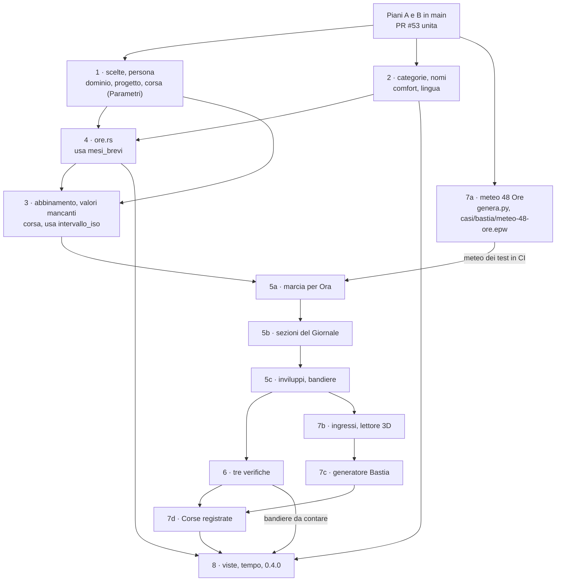

# Piano C — La Corsa fino alla UTCI: annotazione di dispatch

> **Stato, 2026-11-23.** I difetti elencati qui sono stati integrati nei piani, insieme alle decisioni di Mario dello stesso giorno (vedi l'indice). I numeri di riga dei piani citati in questo file si riferiscono alla prima versione, del 2026-11-22: per i difetti fa fede il piano. Restano validi l'assegnazione, l'ordine, i revisori e i riferimenti per task.

Compagno di [`2026-11-22-catena-radiativa-c-corsa.md`](2026-11-22-catena-radiativa-c-corsa.md). Il piano dice **cosa** si costruisce. Questo documento dice **chi** lo costruisce, **in che ordine**, **con quali skill**, **chi rivede**, e quali premesse del piano non reggono al confronto con il codice. Non modifica nessuno step del piano: dove uno step va corretto, la correzione sta nella sezione 6 e il brief del task la porta con sé.

Provenienza: scritto da `/Users/mario/GitHub/OMBRA`, branch `main`, HEAD `d89b78f`, il 2026-11-22. Letti in sessione: il piano C per intero, l'indice dei piani, i piani A e B per intero, la spec alle righe 255-494, `src/corsa.rs`, `src/progetto.rs`, `src/giornale.rs:100-420`, `src/comfort.rs`, `src/meteo.rs:1-330` e `:590-690`, `src/lingua.rs:60-130`, `src/bin/ombra.rs:200-322`, `src/dominio.rs:160-244`, `src/sole.rs`, `src/lib.rs`, `tests/corsa.rs` (testa, `:220-280`, `:540-800`, `:1090-1379`), `tests/cli.rs:50-70` e `:305-350`, `.github/workflows/ci.yml`, `.gitignore`, `casi/bastia/progetto/`, i commenti di risoluzione di #20, #21, #24, #25, #28, #63, e le righe di `docs/ricerca/` citate sotto. Tre comportamenti di `toml` 0.8.23 (la versione di `Cargo.lock`) sono stati **eseguiti** in un crate di prova, non dedotti: li cita la sezione 6.

Esecuzione prevista con `superpowers:subagent-driven-development`: un implementatore per task, il round di revisione dopo ogni task, la revisione ampia a fine ramo. Branch `feat/corsa-tmrt-utci`, dopo che A e B sono in `main`.

---

## 1. Il blocco che ogni dispatch porta addosso

Un subagente non eredita niente: né `CLAUDE.md`, né la spec, né questa pagina. Le righe qui sotto vanno **copiate in ogni brief** di questo piano, poi si aggiungono quelle del task (sezione 4).

1. **Skill.** `skill-gate`: invoca almeno una skill del tuo ruolo prima di leggere o scrivere a mano. `caveman`: il report è in stile `caveman:caveman`. `ponytail`: chi scrive codice invoca `ponytail:ponytail` prima della prima riga. `rust-engineer` invoca anche `rust-skills` (prefissi `err-`, `own-`, `test-`) e `superpowers:test-driven-development`.
2. **Riferimento.** Il brief del task cita la riga di ricerca che lo governa, nella forma `docs/ricerca/<file>.md:<riga>`, oppure la riga esatta `- nessun riferimento pertinente`. Le decisioni stanno nei commenti di risoluzione dei ticket: `gh issue view <n> --comments`.
3. **Provenienza del brief.** Ogni affermazione sul codice esistente porta un `file:riga` letto nella sessione che scrive il brief. Il piano C cita righe di `src/` alla HEAD `d89b78f`: dopo A e B sono scalate, quindi si rileggono, non si copiano.
4. **Le righe dei raster corrono da nord.** Riga 0 è la più settentrionale, ovunque nel progetto.
5. **Il vocabolario di `CONTEXT.md` è vincolante** nei nomi di tipi, campi del Giornale e messaggi: Ora, Corsa, Giornale, Muro, Stato termico, Temperatura media radiante, Flusso radiativo, UTCI, Categoria di stress, Modello di cielo, Postura.
6. **Comandi.** `export PATH=$HOME/.cargo/bin:$PATH` prima di `cargo`. Il cancello è `cargo fmt -p ombra --check`, `cargo clippy -p ombra --all-targets --all-features -- -D warnings`, `cargo test -p ombra --all-features`. Mai `cargo fmt --all`: entra in `vendor/solweig/`, che non si tocca.
7. **Il file meteo di Bastia non c'è.** `casi/bastia/progetto/periodi/estate.toml:2` punta a `materiale università/`, che è in `.gitignore:2` e manca anche su questa macchina. In CI i test che lo leggono sono `#[ignore]` e risultano «ignored»: il verde non prova niente su di loro. Ogni misura «su Bastia con il file vero» è uno step di Mario (HITL).
8. **Tre trappole di `toml` 0.8, eseguite.** Un `None` dentro un array non si serializza (`UnsupportedNone`): nel Giornale il valore mancante è `NaN`, come vuole `src/giornale.rs:219-220`. `Giornale::annota` mette ogni valore sotto una chiave di primo livello (`src/giornale.rs:356-364`): un valore che non è una tabella finisce dentro la tabella precedente quando il file si rilegge, quindi ogni sezione nuova è una struct. Una mappa con chiavi intere non si serializza (`KeyNotString`): le chiavi del Giornale sono stringhe o diventano un array di tabelle.
9. **Il piano non è vangelo.** La sezione 6 elenca i difetti già trovati e la loro correzione. Se ne trovi un altro, fermati e riportalo con la prova: la decisione resta al controllore.
10. **`git add` con percorsi espliciti**, mai `-A` o `.`. Un commento descrive il codice com'è adesso; ciò che verrà si scrive al futuro. Nessun identificativo inventato: ogni riga di monte si rilegge al pin `41840b7` e si cita.

---

## 2. Assegnazioni in breve

| # | Task | Subagente | Skill-gate | Ordine | HITL | Revisori oltre al round base |
|---|---|---|---|---|---|---|
| 1 | Tre scelte del Progetto, persona | `rust-engineer` | true | onda 1, parallelo a 2 | PR #53 unita prima | `security-reviewer` mirato |
| 2 | Categorie di stress, nomi | `rust-engineer` | true | onda 1, parallelo a 1 | — | — |
| 7a | Il meteo di 48 Ore | `coder` | true | onda 1, worktree a parte | Mario lancia il generatore | — |
| 4 | Come si scrive un'Ora | `rust-engineer` | true | dopo 1 e 2 | — | — |
| 3 | Record dell'Ora, valore mancante | `rust-engineer` | true | dopo 4 | Mario: minuto dell'EPW; decisione D1 | `security-reviewer` mirato |
| 5a | La marcia per Ora | `rust-engineer` | true | dopo 3 e 7a | — | — |
| 5b | Le sei sezioni nuove | `rust-engineer` | true | dopo 5a | — | — |
| 5c | Inviluppi e bandiere | `rust-engineer` | true | dopo 5b | Mario: cancello col file vero | — |
| 6 | Le tre verifiche | `rust-engineer` | true | dopo 5c | Mario: soglie col file vero (D2) | — |
| 7b | Ingressi e lettore dei record | `rust-engineer` | true | dopo 5c, parallelo a 6 solo in worktree | — | — |
| 7c | Le due parti del generatore | `coder` | true | dopo 7b | Mario lancia il generatore | — |
| 7d | Le Corse registrate | `rust-engineer` | true | dopo 7c e 6 | — | — |
| 8 | Viste, tempo, 0.4.0 | `rust-engineer` | true | ultimo | Mario: tempi col file vero | — |

Nessun task ha `skill-gate: false`: ognuno scrive logica o test, e nessuno è un rename o una riga di configurazione.

**Il round base, dopo ogni task**, in parallelo e in sola lettura: `code-reviewer`, `test-writer`, `craft-reviewer`, `spec-reviewer` (la spec esiste), più `rust-reviewer` quando il diff tocca `.rs`, cioè sempre tranne 7a e 7c. `security-reviewer` siede in ogni round con una domanda sola, quella del task; nei task senza confine di fiducia la domanda è «un ingresso del Progetto o del file meteo può far andare in panic la Corsa?». `craft-reviewer` legge i messaggi d'errore, le note del Giornale e le viste: in questo piano c'è prosa per un umano in ogni task. `norme-reviewer` non entra: nessun valore NTC. I findings di `spec-reviewer` restano in un report separato.

**La ricerca governa cinque task su tredici.** Gli altri hanno la decisione in un ticket e non in `docs/ricerca/`: lo dice la riga di ciascuno.

---

## 3. Il grafo delle dipendenze vere

**Perché queste frecce e non altre.**

- **1 e 2 in parallelo** solo se il task 1 lascia il messaggio della soglia in `ProgettoError` (difetto 15). Allora toccano file disgiunti: 1 scrive `dominio.rs`, `progetto.rs`, `corsa.rs`, `persona.rs`, `lib.rs`, `da_inx.rs` e i loro test; 2 scrive `comfort.rs`, `lingua.rs` e i loro test.
- **4 dopo 2** perché `vista` legge `Messaggi::mesi_brevi`, che nasce in 2. **4 dopo 1** perché tutti e due aggiungono un modulo a `src/lib.rs`.
- **3 dopo 4** perché `MeteoMancante` porta l'Ora in ISO (`intervallo_iso`). **3 dopo 1** perché tutti e due scrivono `src/corsa.rs` e `tests/corsa.rs`.
- **5a dopo 7a**: i test della Corsa hanno bisogno di un meteo che esista in CI (difetto 1). Il piano mette il file di 48 Ore al task 7, che arriva dopo. 7a lo anticipa, e il generatore non dipende da niente del piano C.
- **5a, 5b, 5c, 6, 3** scrivono tutti `src/corsa.rs` e `tests/corsa.rs`: sequenziali, senza eccezioni.
- **7b in parallelo a 6** solo con `isolation: "worktree"`. I file sono disgiunti (`tests/bastia_registrata.rs`, `tests/comune/record.rs` contro `src/corsa.rs`), ma nello stesso albero un `cargo test` di 7b compila il `corsa.rs` che 6 sta scrivendo. Fuori da un worktree, un implementatore alla volta.
- **7a in parallelo a 1 e 2** in un worktree a parte: Python e un file di dati, nessun `.rs`.
- **8 dopo 6**: `riassunto` deve contare le bandiere delle tre verifiche nuove (difetto 13).

---

## 4. Task per task

Ogni brief = il blocco della sezione 1 + la riga di riferimento + le correzioni della sezione 6 indicate qui + gli step del piano.

### Task 1 — Le tre scelte del Progetto e la persona

- **Subagente:** `rust-engineer`. Tipi, serializzazione, validazione: Rust puro, nessuna superficie.
- **Riferimento:** `- nessun riferimento pertinente`. Motivo: le decisioni stanno in #20 (soglia, `wall_aspect.rs:156`) e #28 (persona, `constants.py:56-57`, `config.py:289-290`), e nessuna ricerca in `docs/ricerca/` copre il manifesto.
- **Ordine:** onda 1, parallelo a 2 e a 7a. **Prima di partire** la PR #53 deve essere unita: oggi è `OPEN` (`gh pr view 53`), e il task nomina `Postura` nel codice (indice dei piani, riga 19).
- **Correzioni da portare nel brief:** difetti 5, 8, 14, 15.
- **HITL:** l'unione di #53.
- **Revisori:** round base. `security-reviewer` mirato: il manifesto è un file che gli utenti si scambiano. `nan` e `inf` si scrivono in TOML e arrivano a `valida`: si rifiutano lì, a `scrivi` e a `leggi`.
- **Fatto quando:** un manifesto della 0.3.0 si legge con i predefiniti, quello del caso di riferimento compreso, e i cinque test del piano falliscono se si toglie la riga che difendono.

### Task 2 — Categorie di stress e nomi nelle due lingue

- **Subagente:** `rust-engineer`.
- **Riferimento:** `- nessun riferimento pertinente`. Motivo: le soglie sono quelle di Bröde et al. (2012) già in `src/comfort.rs:87-100`, la decisione dei nomi è in #25 e nella spec, righe 373-376.
- **Ordine:** onda 1, parallelo a 1.
- **Correzioni da portare nel brief:** difetto 20.
- **Revisori:** round base. `craft-reviewer` legge i venti nomi delle Categorie e i dodici mesi in due lingue.
- **Fatto quando:** `fuori_intervallo` e `banda` non esistono più, nessun commento li nomina, e il test della sentinella −999 (`tests/comfort.rs:166`) gira contro `estrapolata`.

### Task 7a — Il meteo di 48 Ore (anticipato dal task 7, step 1)

- **Subagente:** `coder`. Python e un file di dati. Skill: `ponytail:ponytail`, `caveman:caveman`, `wizard` per lo step che lancia Mario.
- **Riferimento:** `docs/ricerca/04-stato-termico.md:151`. La misura Corsa A contro Corsa B dice come costruire il meteo: sera coperta con clearness index sotto 0,95 portata oltre la mezzanotte, e una seconda giornata da cui far partire una Corsa B.
- **Ordine:** onda 1, in un worktree a parte.
- **Cosa consegna:** la parte `meteo-48-ore` di `strumenti/record/genera.py` e `casi/bastia/meteo-48-ore.epw`, giorni interi dall'ora 1 all'ora 24, con globale, diretta e diffusa a zero nelle Ore di notte piena. Le date si scrivono nel commento del generatore e servono a 5a, 6 e 7d.
- **HITL:** Mario lancia il generatore e committa il file.
- **Revisori:** `code-reviewer`, `spec-reviewer`, `security-reviewer` (domanda: il generatore scrive solo in `casi/bastia/` e `tests/record/`?).
- **Fatto quando:** `Epw::leggi` legge il file senza errori, e `ore_dal` per 48 Ore dal primo giorno restituisce 48 record.

### Task 4 — Come si scrive un'Ora

- **Subagente:** `rust-engineer`.
- **Riferimento:** `- nessun riferimento pertinente`. Motivo: la decisione è il commento di risoluzione di #63, non una ricerca.
- **Ordine:** dopo 1 e 2.
- **Correzioni da portare nel brief:** difetto 23.
- **Revisori:** round base. `craft-reviewer` sul trattino U+2013 e sulla forma «21 giu».
- **Fatto quando:** i sei test del piano più i casi del difetto 23 passano, e `ore.rs` espone anche il giorno di calendario dell'Ora, che 5a usa per `altezza_massima_del_giorno`.

### Task 3 — Il record dell'Ora e il valore mancante

- **Subagente:** `rust-engineer`.
- **Riferimento:** `docs/ricerca/02-sole-meta-passo.md:105`. Lo scarto a Bastia è misurato abbinando lo step k al record EPW k+1 con il sole a `etichetta − 30 min`: è l'abbinamento che questo task scrive.
- **Ordine:** dopo 4 e 1.
- **Correzioni da portare nel brief:** difetti 2, 7, 19, 21.
- **HITL:** lo step 1 del piano (minuto dell'EPW di Bastia, letto da Mario). La decisione D1 prima di scrivere i test.
- **Revisori:** round base. `security-reviewer` mirato: il file meteo è un ingresso esterno, e il controllo dei valori mancanti precede ogni chiamata al Motore.
- **Fatto quando:** i due test di arresto passano, e i test di oggi che si appoggiano a un file meteo assente sono stati riscritti secondo D1, senza lasciarne uno che passa per il motivo sbagliato.

### Task 5a — La marcia per Ora

- **Subagente:** `rust-engineer`.
- **Riferimento:** `docs/ricerca/04-stato-termico.md:102` (notte = sole al centro dell'Ora a quota ≤ 0) e `docs/ricerca/01-passo-fuso.md:186` (il passo gira anche di notte, nessun ritorno anticipato, e lo stato che il chiamante aggiorna dopo).
- **Cosa contiene:** lo step 3 del piano (`marcia`), i campi nuovi di `Campi` e `SerieDiPunto`, la sezione `[ore]`, la UTCI sul campo. Test: `il_giornale_scrive_la_lista_delle_ore` e i due test spostati dal task 3, `l_ora_k_prende_il_record_k_piu_uno` e `il_vento_mancante_lascia_senza_utci_solo_quell_ora`.
- **Ordine:** dopo 3 e 7a.
- **Correzioni da portare nel brief:** difetti 1, 3, 4, 7, 24.
- **Revisori:** round base.
- **Fatto quando:** una Corsa su un Progetto con il meteo di 7a riesce, ogni serie ai Punti ha `periodo.ore` elementi, e il passo gira dentro `pool_a_un_thread()`.

### Task 5b — Le sei sezioni nuove del Giornale

- **Subagente:** `rust-engineer`.
- **Riferimento:** `docs/ricerca/04-stato-termico.md:257` (un Periodo senza Ore di notte: è l'unico caso in cui `ore_dallo_stato_iniziale` non vale zero).
- **Cosa contiene:** `[cielo]`, `[persona]`, `[suolo]`, `[muri]`, `[stato_termico]`, `[utci]`, con i sei test del piano.
- **Ordine:** dopo 5a.
- **Correzioni da portare nel brief:** difetti 6, 10, 12.
- **Revisori:** round base. `craft-reviewer` con priorità: sono le note che un lettore del Giornale ha e nient'altro.
- **Fatto quando:** ogni sezione si rilegge con il parser TOML, e ogni valore che viene da monte porta la sua riga al pin.

### Task 5c — Inviluppi e bandiere

- **Subagente:** `rust-engineer`.
- **Riferimento:** `- nessun riferimento pertinente`. Motivo: la tabella degli intervalli è in #25 e nella spec, righe 344-351.
- **Cosa contiene:** l'Ora e la cella degli estremi in `Inviluppo`, la bandiera della Tmrt Ora per Ora, quella della UTCI, i Flussi radiativi ai Punti. Test: `gli_inviluppi_di_tmrt_e_utci_hanno_ora_e_cella`, `la_bandiera_della_tmrt_si_alza_fuori_intervallo`, `la_utci_senza_vento_non_alza_la_bandiera`.
- **Ordine:** dopo 5b.
- **Correzioni da portare nel brief:** difetto 9.
- **HITL:** lo step 4 del piano (il cancello dei 60 secondi) chiede il file vero di Bastia. Mario lo lancia e il tempo va nel messaggio del commit; senza il file, il commit dice che il cancello non è stato misurato.
- **Revisori:** round base.
- **Fatto quando:** una Tmrt costruita a Ta + 71 e una con un NaN alzano la bandiera passando per la funzione pubblica del difetto 9, e una UTCI senza vento non la alza.

### Task 6 — Le tre verifiche nuove

- **Subagente:** `rust-engineer`.
- **Riferimento:** `docs/ricerca/01-passo-fuso.md:186` (di notte il passo mette tutto al sole e K↓ si riduce alla diffusa del record) e `docs/ricerca/02-sole-meta-passo.md:105` (il residuo d'algoritmo fra i due soli, che dà la scala della soglia delle due ombre).
- **Ordine:** dopo 5c.
- **Correzioni da portare nel brief:** difetto 17.
- **HITL:** lo step 2 del piano (soglie misurate su Bastia), secondo la decisione D2.
- **Revisori:** round base. `craft-reviewer` sulle tre `nota`.
- **Fatto quando:** ognuna delle tre verifiche alza la bandiera sia quando trova un difetto sia quando non ha potuto girare, e ogni soglia porta nel commento la misura da cui viene, con il file meteo usato.

### Task 7b — Ingressi e lettore dei record

- **Subagente:** `rust-engineer`.
- **Riferimento:** `docs/ricerca/04-stato-termico.md:151`.
- **Cosa contiene:** un test `#[ignore]` che scrive in `tests/record/` i raster che la Derivazione e i Muri di OMBRA producono per lo Scenario scelto (D6), perché il generatore li dia alla wheel; un lettore a tre dimensioni accanto a `leggi_campo` in `tests/comune/record.rs`.
- **Ordine:** dopo 5c; parallelo a 6 solo in worktree.
- **Correzioni da portare nel brief:** difetto 16.
- **Revisori:** round base.

### Task 7c — Le due parti del generatore

- **Subagente:** `coder`. Skill: `ponytail:ponytail`, `caveman:caveman`, `wizard`.
- **Riferimento:** `docs/ricerca/04-stato-termico.md:151`.
- **Cosa contiene:** le parti `bastia-uniforme` e `bastia-com-e` di `genera.py`, che leggono gli ingressi di 7b e il meteo di 7a.
- **HITL:** lo step 2 del piano: Mario lancia il generatore.
- **Revisori:** `code-reviewer`, `spec-reviewer`, `security-reviewer` (stessa domanda di 7a).

### Task 7d — Le Corse registrate

- **Subagente:** `rust-engineer`.
- **Riferimento:** `docs/ricerca/04-stato-termico.md:151`.
- **Cosa contiene:** gli step 3-5 del piano, con il terzo test sostituito come dice il difetto 16.
- **Ordine:** dopo 7c e 6.
- **Revisori:** round base.
- **Fatto quando:** *Bastia uniforme* sta entro 1e-3 °C in ogni cella e ogni Ora, e le due soglie di *Bastia com'è* portano la misura nel commento.

### Task 8 — Le viste, il tempo e la versione

- **Subagente:** `rust-engineer`.
- **Riferimento:** `- nessun riferimento pertinente`. Motivo: la vista è decisa in #63, i tempi attesi sono misurati in #24.
- **Ordine:** ultimo.
- **Correzioni da portare nel brief:** difetti 13, 18, 22.
- **HITL:** lo step 4 del piano. Il cancello chiede il file vero di Bastia; il tetto di progetto gira sul Progetto sintetico. Se il tetto supera 10 minuti, ci si ferma: la scelta di cosa dire all'utente è di Mario.
- **Revisori:** round base. `craft-reviewer` sulle tabelle in due lingue: sono la vista alternativa alla mappa che l'obiettivo WCAG chiede.

---

## 5. Cosa si guarda per accorgersi in tempo che va storto

- **Il passo fuori dal pool.** #24 misura il caso di riferimento anisotropo a circa 2,7 s, un limite superiore, contro un budget di 60. Lo stesso nucleo chiamato fuori da `install` costa 12 volte di più con un thread e 1066 volte con il pool predefinito. Il segnale è un test di 5a che passa da secondi a minuti in debug: si guarda `pool_a_un_thread()` prima di ottimizzare altro.
- **Un test che passa senza il codice che difende.** In questo piano succede in tre punti (difetti 8, 9, 10). La prova di ogni test nuovo è vederlo rosso togliendo la riga che lo fa verde.
- **Un Giornale che non si rilegge.** Le trappole TOML della sezione 1 non danno errore al compilatore. Danno `GiornaleError::Sezione` a run time, oppure un file che si rilegge con le chiavi nella tabella sbagliata.

---

## 6. Difetti del piano, verificati contro il codice

In ordine di gravità. «C:n» è la riga del piano C, «spec:n» quella della spec.

**Bloccanti: senza correzione il task non si chiude.**

1. **I test «sul caso di riferimento» non girano in CI.** C:216 scrive i test del task 5 «sul caso di riferimento, con `esegui`». Il suo meteo punta a `materiale università/` (`casi/bastia/progetto/periodi/estate.toml:2`), che è in `.gitignore:2`, non è sul runner (`ci.yml`, commento sopra il passo «Tests») e non è nemmeno su questa macchina (`ls "materiale università"` fallisce da `/Users/mario/GitHub/OMBRA`). Tutto ciò che il piano misura «su Bastia» con il file vero — C:241, C:274, C:350 — è uno step di Mario non dichiarato. **Correzione:** i test di 5a, 5b, 5c e 6 girano su un Progetto sintetico con il meteo di 7a, versionato e ridistribuibile. Il cancello e le misure col file vero restano HITL (D2).

2. **Una Corsa senza file meteo leggibile: il piano non decide.** Oggi corre e ripiega sul fuso della longitudine (`src/corsa.rs:320-326`, `src/meteo.rs:310-313`), e un test lo fissa (`tests/corsa.rs:1094`). Con la Tmrt non c'è niente da calcolare senza meteo. Il task 3 tocca `coordinate` (C:124) e non dice cosa diventa. La metà dei test della Corsa usa `periodo()`, che punta al file assente (`tests/corsa.rs:560-571`): quindici chiamate a `scrivi_ed_esegui` fra `tests/corsa.rs:587` e `:1364`. **Correzione:** D1 prima del task 3. Con la raccomandazione di D1, quei test ricevono un EPW sintetico; l'aiutante `scrivi_epw_di` (`tests/corsa.rs:753`) prende la data come parametro.

3. **`Vec<Option<f64>>` non entra nel Giornale.** C:206 dà a `SerieDiPunto` `pub utci: Vec<Option<f64>>`, e la serie si scrive con `giornale.annota("serie", …)` (`src/corsa.rs:810`). Eseguito su `toml` 0.8.23: `Err(UnsupportedNone)`. La Corsa con un'Ora senza vento fallirebbe nello scrivere il Giornale. **Correzione:** `utci: Vec<f64>` con `NaN` dove manca, la convenzione del progetto (`src/giornale.rs:219-220`); `toml` scrive `nan` e lo rilegge. In `Campi` `Vec<Option<Raster>>` resta, perché non si serializza.

4. **«La chiave `ore`» non esiste in questa forma.** C:217 la vuole nel Giornale. `annota` la metterebbe al primo livello (`src/giornale.rs:356-364`). Eseguito: un array di stringhe scritto dopo una sezione si rilegge *dentro* quella sezione. E `[periodo] ore` è già il numero delle Ore (`src/corsa.rs:227`). **Correzione:** una sezione `[ore]` con la chiave `intervalli`, scritta prima di `[[serie]]`; il test legge `tabella["ore"]["intervalli"]`.

**Alti: il test o il comportamento esce sbagliato senza che nessuno se ne accorga.**

5. **`ScelteDiProgetto` senza `Default`, e il `#[serde(default)]` nel posto sbagliato.** C:47 non deriva `Default`, che `#[serde(default)] pub scelte` (C:52) richiede. Il `derive(Default)` istintivo darebbe `soglia_del_muro_m = 0.0`, e `valida` rifiuterebbe **ogni** Progetto della 0.3.0 con `SogliaDelMuro`. Poi: `leggi` non deserializza `Progetto` ma `Manifesto` (`src/progetto.rs:100-106`, `:323`), e costruisce `Progetto` a mano (`:334-340`); `scrivi` fa il contrario (`:311-317`). Un attributo su `Progetto` non cambia niente. **Correzione:** `impl Default for ScelteDiProgetto` scritto a mano con 1,0, il campo `#[serde(default)] scelte` su `Manifesto`, copiato nei due sensi. Eseguito: così un manifesto della 0.3.0 si legge con `anisotropo`, `in piedi`, 1,0, e `"in piedi"` fa andata e ritorno in TOML. Nell'Impronta entra tramite `toml::to_string(&Parametri)` (`src/corsa.rs:640`), che lo scrive allo stesso modo.

6. **Il Review Focus 1 dice il contrario di #21.** C:19: «Le Ore fino al primo giorno dipendono dallo Stato termico iniziale». La decisione 7 di #21 dice che un Periodo che **comincia di notte** non dipende da niente — la notte azzera lo stato, e lo stato iniziale di monte vale quanto quello azzerato — e che «a Bastia il conteggio è sempre zero». Ciò che dipende dalla sera prima è la Tmrt prima dell'alba, attraverso il clearness index, che ha la sua voce. Il test `la_sezione_stato_termico` (C:222) non ha oracolo per `ore_dallo_stato_iniziale`. **Correzione:** il conteggio vale 0 se l'Ora 0 ha il sole al centro a quota ≤ 0; altrimenti è l'indice della prima Ora notturna più uno, perché quell'Ora si calcola ancora con lo stato del giorno (`docs/ricerca/01-passo-fuso.md:186`, §4, «Il primo passo notturno»); senza notte vale `periodo.ore`. Oracoli: 0 sul Progetto sintetico a Bastia, `periodo.ore` a Tromsø il 21/6 (`docs/ricerca/04-stato-termico.md:257`).

7. **Due test del task 3 hanno bisogno della Tmrt, che nasce al task 5.** `il_vento_mancante_lascia_senza_utci_solo_quell_ora` (C:140) controlla `tmrt[2]`; `l_ora_k_prende_il_record_k_piu_uno` (C:137) «usa 10, 11, 12», e l'unico posto in cui la temperatura si vede è la UTCI. Al task 3 non possono diventare verdi. **Correzione:** si spostano in 5a. L'oracolo del secondo: `serie.utci[k] == comfort::utci(T_k, UR, serie.tmrt[k], v)`, con `T_k` = 10, 11, 12. Al task 3 restano i due test di arresto, con l'oracolo «nessuna sezione `[cielo]` nel Giornale» per «prima di ogni passo».

8. **`ogni_scelta_cambia_l_impronta` passa anche senza l'implementazione.** Se il test passa da `esegui_progetto`, il manifesto è già un Ingresso con la sua somma (`src/corsa.rs:842`): cambiando una scelta cambia il file, quindi l'Impronta, anche se `Parametri` resta com'è. **Correzione:** il test chiama `corsa::esegui` con lo stesso slice di `ingressi` per le due Corse della coppia, così l'unica differenza è `parametri`.

9. **La bandiera della Tmrt non ha una funzione da chiamare.** C:225 vuole «un `Inviluppo` costruito con una Tmrt di Ta + 71». Da `esegui` una Tmrt così non si ottiene. `inviluppo` prende un intervallo solo e tratta il NaN come «senza dato», senza bandiera (`src/giornale.rs:224-255`), mentre la spec vuole la bandiera su un NaN (spec:346) e un intervallo che dipende dalla Ta dell'Ora. Lo stesso per la UTCI (C:226, spec:347). **Correzione:** una funzione pubblica per campo orario in `src/giornale.rs`, che prende i raster per Ora, la Ta per Ora e la lista `[ore]`, e restituisce l'`Inviluppo` con estremi, Ora, cella e bandiera. I due test la chiamano direttamente. `intervallo_plausibile` della Tmrt scrive `(-30, 70)` e la `nota` dice che è Tmrt − Ta.

**Medi: lavoro buttato o rimandato se non si corregge prima.**

10. **`una_corsa_isotropa_non_conserva_le_matrici` è una tautologia.** C:227 la verifica con `[cielo] matrici_conservate = false`. Se il campo si scrive dalla scelta, il test passa anche quando `cielo` riceve `true`. E il campo non è nella spec (spec:322-324). Il test della spec «con `anisotropo` e una matrice mancante la Corsa si ferma» (spec:414) da `esegui` non si scrive, perché la Corsa conserva sempre le matrici con `anisotropo`; lo copre il task 4 del piano A (`anisotropo_senza_matrici_si_ferma`). **Correzione:** `matrici_conservate` si scrive da `cielo.matrici.is_some()`, cioè dall'oggetto restituito, e la differenza dalla spec va a D4. Il report di 5b dichiara che il test di spec:414 vive nel seam del Motore.

11. **Il task 5 è troppo grosso.** Tocca cinque sezioni di `src/corsa.rs` (C:193), `Inviluppo`, sei sezioni del Giornale e undici test: un solo commit, un solo round di revisione. **Correzione:** 5a, 5b, 5c come nella sezione 4. Restano sequenziali, perché tutti e tre scrivono `src/corsa.rs` e `tests/corsa.rs`; si guadagnano tre revisioni piccole al posto di una enorme.

12. **`[suolo]` non si serializza con il conteggio di B.** B dà `ConteggioDelSuolo { per_classe: BTreeMap<u8, usize>, … }` (piano B, task 3). Eseguito: `Err(KeyNotString)`. **Correzione:** in `[suolo]` un array di tabelle, una per tipo di Superficie presente, con classe di monte, cinque valori, riga e celle; il conteggio delle predefinite e la nota sull'acqua accanto.

13. **`interroga` conta una sola verifica.** `riassunto` somma la bandiera di `verifica_ombra` e basta (`src/bin/ombra.rs:260-265`). Con tre verifiche nuove che alzano la bandiera anche quando non girano, il riassunto direbbe «nessuna bandiera» su un Giornale che ne ha. Il task 8 (C:334-338) non lo chiede. **Correzione:** un test in `tests/cli.rs` con una delle tre verifiche a `bandiera = true`, e `riassunto` che conta ogni sezione `verifica_*`.

14. **Il task 1 non elenca tutti i file che deve toccare.** Aggiungere `scelte` a `Progetto` rompe ogni letterale: `src/da_inx.rs:313`, `src/progetto.rs:334`, `tests/cli.rs:104`, `tests/corsa.rs:508`, `tests/progetto.rs:5` e `:494`. C:30-33 e il `git add` di C:73 non hanno `src/da_inx.rs` né `tests/cli.rs`. **Correzione:** si aggiungono ai file e al `git add`.

15. **«`src/lingua.rs` per il messaggio» è uno step che non decide.** C:32 e C:124. Oggi i messaggi di `ProgettoError` e `CorsaError` stanno nel loro `Display`, in italiano (`src/progetto.rs:54-94`, `src/corsa.rs:78-99`), e `lingua.rs` serve solo la riga di comando. **Correzione:** `SogliaDelMuro` e `MeteoMancante` seguono le varianti sorelle nel `Display`. Così il task 1 non tocca `lingua.rs` e può girare in parallelo al task 2. Debito da segnare: `CLAUDE.md` vuole ogni messaggio in `lingua.rs`, e gli errori di dominio non ci sono mai stati.

16. **Il task 7 manca di tre pezzi e ha un test vuoto.** Il lettore di B dà `Array2` (`leggi_campo`, piano B, task 1), mentre C:302 registra «il campo Tmrt intero per Ora», cioè tre dimensioni. Il generatore non ha da dove prendere il modello di superficie, le chiome e i Muri di OMBRA: OMBRA non esporta raster. C:302-303 non nomina lo Scenario né le date, e tutti e due gli Scenari di Bastia hanno alberi (616 e 846 `[[alberi]]`). `lo_stato_termico_attraversa_due_notti` (C:309) non afferma niente che il primo test non copra già. **Correzione:** 7b porta l'esportazione e il lettore a tre dimensioni. Il terzo test diventa la misura di `docs/ricerca/04-stato-termico.md:151`: Corsa A di 48 Ore dal primo giorno, Corsa B di 24 Ore dal secondo, Tmrt uguale bit per bit in ogni Ora del secondo giorno. Fallisce se si sbaglia la ricerca della sera all'indietro o se lo stato non si azzera di notte.

17. **Le verifiche del task 6 non hanno un meteo su cui girare.** I due aiutanti EPW dei test scrivono globale 120, diretta 300 e diffusa 80 a ogni ora, mezzanotte compresa (`tests/corsa.rs:753-772`, `tests/cli.rs:50-68`). Con quel file `la_notte_piena_e_buia` (C:268) alza la bandiera, giustamente. «Un Periodo di sole Ore diurne» (C:270) a Bastia non esiste, perché l'Ora 0 comincia a mezzanotte. **Correzione:** le verifiche si provano sul meteo di 7a, che ha la notte a zero. Il Periodo tutto diurno si fa con l'origine della Griglia a Tromsø il 21/6, come fa già `cammina_col_sole_al_centro` (`tests/corsa.rs:788-793`) spostando la latitudine.

**Bassi: si correggono nel task, senza fermarsi.**

18. **Un test del task 8 nomina il caso di riferimento.** C:336, «la prima riga del caso di riferimento». `tests/cli.rs` lavora su un Progetto sintetico (`:101-142`). **Correzione:** «del Progetto di `scrivi_progetto`».

19. **Due commenti diventano falsi al task 3.** `src/meteo.rs:612-613` («No Corsa calls this yet») e la promessa di `:611-612` che il Giornale dirà quando il Periodo si avvolge sul file. **Correzione:** il task 3 aggiorna il primo e scrive l'avvolgimento nel Giornale secondo D3.

20. **Nomi e commenti del task 2.** Il commento di `utci` nomina `fuori_intervallo` due volte (`src/comfort.rs:20`, `:29`). Eseguito: `serde` scrive gli enum con il nome della variante, `"TemperaturaDellAria"`. **Correzione:** `#[serde(rename_all = "snake_case")]` su `CategoriaDiStress` e `LimiteSuperato`; `categoria_di_stress` legge `SOGLIE_DELLE_CATEGORIE`, così le soglie hanno una fonte sola; il Giornale dice che il limite inferiore è escluso, come in `banda` (`v > 46.0`).

21. **L'abbinamento di `ore_dal` è giusto, e ha una trappola di lettura.** «Record k + 1» (C:128, spec:265) è il (k+1)-esimo record contato dall'ora 1, cioè l'elemento **di indice k** del vettore restituito: `ore_dal` parte da `primo_del(inizio)` (`src/meteo.rs:685-689`) e ne restituisce uno per Ora (`:647-671`). Indicizzare `k + 1` sposta tutto di un'Ora. Il test di C:137 (10, 11, 12) lo coglie.

22. **La versione sale al task 8, la spec la vuole con la catena.** spec:314-315. Il ramo si unisce con una sola PR, quindi `main` non vede mai una 0.3.0 con il Giornale nuovo. Si tiene il piano, e il report del task 8 lo dichiara.

23. **Casi del task 4 che mancano.** Il fuso +05:45, che un test di oggi usa già (`tests/corsa.rs:1082`); il 28/2/2024 all'Ora 24, che dà il 29; la vista dell'Ora 24, che è il giorno dopo, «0–1».

24. **Il cancello dei 60 secondi.** Il rischio è basso, e la misura sta in #24: circa 2,7 s sul caso di riferimento con l'anisotropo, limite superiore con i Muri spenti. Il rischio vero è il passo fuori dal pool (sezione 5). La doppia ombra per Ora (spec, «Note») si misura al task 5c insieme al resto.

**Dal piano A, da chiudere quando la Corsa chiama `PassoDelloScenario`.** Righe verificate su `feat/passo-vendorato` a `3c83954`.

- **Messaggi fuori da `lingua.rs`.** Tre stringhe italiane nel codice di `src/motore.rs`: in `nuovo`, il cielo anisotropo senza matrici (`:641`); in `ora`, il campo che `OUT_ALL` chiede e manca (`:799`); in `stessa_forma` (`:827-829`). Con loro la stringa già presente dei più di due Strati di `cielo`, che `sky_view_factor` restituisce (`:414`). Vanno in `src/lingua.rs` con un errore tipizzato del Motore.
- **`cielo` e `strati` da Strati diversi.** `IngressiDelloScenario` li riceve separati (`src/motore.rs:538`, `:544`), e devono venire dagli stessi Strati. Niente lo controlla: una discordanza dà una Tmrt sbagliata in silenzio.
- **Il sole basso.** `ombre` dà tutto in ombra a 2° o meno (`src/motore.rs:51`, `:75`); `ora` (`:702`) non ha soglia e lascia quella del passo, 3° (`vendor/solweig/src/pipeline.rs:324`, a monte `rust/src/pipeline.rs:671`). Fra 2° e 3° le due ombre non coincidono.
- **La maschera degli edifici.** OMBRA chiama Edificio ogni cella con `costruite > 0` (`src/motore.rs:840-841`); `detect_building_mask` di monte vuole almeno 2 m sopra il DEM (`pysrc/solweig/components/gvf.py:23`, `:54`).
- **`rilievo` su un modello di superficie tutto NaN** dà `-inf` (`src/motore.rs:154-165`); monte dà 0 (`pysrc/solweig/models/surface.py:257-258`).
- **Le etichette di forma non nominano lo Strato.** «le chiome di uno Strato» e «la zona-tronco di uno Strato» (`src/motore.rs:633-634`) non dicono quale; il nome c'è, `StratoDiChioma.nome` (`src/derivazione.rs:121`).

**Verificate e vere, senza correzione.** `#[serde(default)]` su `Manifesto` legge un manifesto della 0.3.0 con i predefiniti (difetto 5, eseguito). `"in piedi"` fa andata e ritorno in TOML e nell'Impronta. `ore_dal` rileva un file che comincia a metà giornata con `GiornoMonco` (`src/meteo.rs:654-668`). `valida` gira sia in `scrivi` sia in `leggi` (`src/progetto.rs:301`, `:341`), quindi la soglia si rifiuta in tutti e due senza codice in più. Le quattro righe di ricerca del brief esistono e dicono quello che il brief dice.

---

## 7. Decisioni che spettano a Mario

- **D1.** Una Corsa senza file meteo leggibile si ferma (raccomandato: non promette una Tmrt che non può calcolare, e toglie il ripiego sulla longitudine) o calcola ombre e Sky view factor e lascia fuori le sezioni radiative?
- **D2.** Le soglie delle due ombre e del cielo aperto si fissano sul meteo sintetico di 7a, riproducibile in CI (raccomandato), con la misura sul file vero riportata accanto, o solo sul file vero?
- **D3.** Un file meteo che non è un anno intero e a cui il Periodo chiede più ore di quelle che ha: si avvolge e il Giornale lo dichiara, o si rifiuta come nella ricerca della sera di #21 (raccomandato)?
- **D4.** `[cielo] matrici_conservate` entra nel Giornale, scostandosi dalla spec (raccomandato, scritto dall'oggetto e non dalla scelta), o il test si toglie?
- **D5.** Unire la PR #53 prima del task 1.
- **D6.** Quale Scenario di Bastia registrare contro monte, e in quali due giorni.

---

## 8. Note di roster

Nessun gap nuovo. `rust-engineer` copre tutti i task di codice; il piano del nucleo dovette ripiegare su `backend-engineer` con il gate soddisfatto altrove, qui non serve. Le tre trappole di serializzazione della sezione 6 sono uscite eseguendo un crate di prova, non leggendo: costa un minuto, e conviene ripeterlo per ogni tipo nuovo che va nel Giornale.
