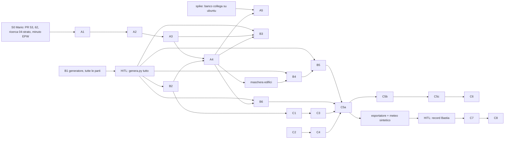

# Revisione trasversale dei piani A, B e C della catena radiativa

> **Stato, 2026-11-23.** I difetti elencati qui sono stati integrati nei piani, insieme alle decisioni di Mario dello stesso giorno (vedi l'indice). I numeri di riga dei piani citati in questo file si riferiscono alla prima versione, del 2026-11-22: per i difetti fa fede il piano. Restano validi l'assegnazione, l'ordine, i revisori e i riferimenti per task.

Questa revisione guarda i tre piani insieme: le giunture fra un piano e l'altro, la copertura
della spec, i confini dei moduli, l'ordine. Non annota i singoli task: assegnazione, skill-gate e
riferimento per task stanno nelle annotazioni dei tre piani.

**Provenienza.** Repository `OMBRA`, branch `main`, HEAD `d89b78f`. Monte letto in un clone a
`41840b7` (`UMEP-dev/solweig`, v0.1.0b101). Ricerca `04-strato-python-monte.md` letta dal branch
`origin/research/strato-python-monte`, perché in `main` non c'è ancora. Ogni rilievo porta la riga
del piano (`A:`, `B:`, `C:`, `indice:`), della spec (`spec:`) o del codice che lo prova.

**Premessa del dispatch corretta.** `src/motore.rs:1-5` dice che il Motore è l'unico modulo che
nomina la copia vendorata. Oggi non è vero: `src/comfort.rs:37` chiama
`solweig_vendorato::utci::utci_single`. Il rilievo 3.1 ne tiene conto.

## Esito in breve

Il taglio in tre piani regge: ogni piano chiude su un seam della spec e produce qualcosa che si
verifica da solo. Prima del dispatch vanno chiusi sette difetti, i primi quattro bloccanti:

1. la **maschera degli edifici** non ha un task, e la convenzione di monte è invertita rispetto a
   quella di OMBRA (§1, rilievo 1.1);
2. la **lettura per cella delle Trasmissività** non ha un test che la veda, contro quanto dice
   `A:20` (§5, rischio 1);
3. il piano B dà **due formule incompatibili** per la Trasmissività verso il cielo (rilievo 1.3);
4. il caso di riferimento **non ha un file meteo in CI**, e il piano C lo usa per i test della
   Corsa (rilievo 2.4);
5. il banco di parità nomina **un crate e una funzione di monte che non sono raggiungibili** così
   come scritti (rilievo 1.4);
6. lo **Stato termico dopo il passo**, di giorno, contraddice monte in un test di B (rilievo 1.6);
7. il **task 5 di C** è troppo grosso per un dispatch (§4).

---

## 1. Il taglio regge? Le giunture fra i piani

Ogni piano produce software verificabile da solo: A chiude sul banco di parità, B sui record di
monte per parte, C sulla Corsa e sulle due Corse registrate. I rilievi sono sulle giunture.

**1.1 Nessuno produce il raster degli edifici, e il passo lo vuole invertito.** `A:208` passa al
passo `edifici: &'a Raster`; `B:145` e `B:203` lo consumano per il suolo e per i Muri. Nessun task
lo produce: `RasterDiScenario` non ha un campo edifici (`src/derivazione.rs:231-241`), e l'altezza
del costruito oggi è una variabile locale di `esegui` (`src/corsa.rs:762`,
`modello_di_superficie − modello_di_terreno`). La spec elenca la «maschera degli edifici» fra le
parti dello strato portato (`spec:234`), e la ricerca 04-strato la tratta in §3.10. Monte la vuole
con **1 dove c'è suolo e 0 sotto un edificio** (`pipeline_inputs.rs:107-108` al pin;
`components/gvf.py:39-58`), mentre `B:164` usa `edifici > 0` per dire «sotto un Edificio». Passare
il raster di OMBRA così com'è inverte la maschera, e il banco non se ne accorge, perché i due lati
ricevono lo stesso ingresso. Lo vedrebbe solo la Corsa registrata del task 7 di C, l'ultimo
controllo del percorso.
*Correzione:* un task nuovo in B, prima del task 3: una sola fonte per «sotto un Edificio», usata
sia dal suolo sia dalla maschera; la conversione alla convenzione di monte avviene **dentro**
`motore`, che riceve l'altezza del costruito con la semantica di OMBRA. Un test fissa il verso
(una cella costruita dà 0 nella maschera passata al passo). La regola, dagli oggetti oppure
`dsm − dem ≥ 2 m` come monte, è una decisione di Mario (§ Decisioni).

**1.2 `Cielo.detrazione` e `Cielo.volta_coperta` non hanno un produttore verificato.** `A:185-186`
li dichiara, `A:241` non dice come si calcolano e nessun test di `A:229-233` li guarda. `B:243`
li consuma e `B:266` li testa. Il difetto nato in A si vede soltanto in B.
*Correzione:* la proposta del rilievo 3.3, cioè calcolare la Trasmissività verso il cielo dentro
`motore::cielo`; in alternativa, un test in A che fissi i due campi su uno e due Strati.

**1.3 Due formule per la Trasmissività verso il cielo.** `B:266` chiede
`trasmissivita_verso_il_cielo == detrazione / volta_coperta`; `B:267` chiede 0,03 per uno Strato
sempreverde. Con la detrazione di oggi, `(1 − svf_veg) · (1 − τ)` (`src/motore.rs:327-329`), e la
volta coperta `1 − svf_veg`, il rapporto vale `1 − τ` = 0,97. ADR 0006 alle righe 34-36 la
definisce come il numero che, messo in `svf − (1 − svf_veg)(1 − psi)`, restituisce la stessa
detrazione: dunque **τ = 1 − detrazione / volta_coperta**. La forma abbreviata di `spec:218` e
dell'ADR 0006 alla riga 98 («dividendo la detrazione per la volta») omette l'«1 −», e `B:266` la
traduce alla lettera.
*Correzione:* `B:266` diventa `1 − detrazione / volta_coperta`. Conviene correggere la frase anche
in `spec:218`, perché la leggerà chi esegue.

**1.4 Il banco nomina un crate e una funzione di monte che non si raggiungono.** `A:259` dichiara
`solweig = { path = "monte/rust" }`, ma il pacchetto al pin si chiama `rustalgos`
(`rust/Cargo.toml:2`): serve `package = "rustalgos"`. Il crate ha poi `default = ["gpu"]`
(`rust/Cargo.toml:25-27`), che tira dentro `wgpu`: serve `default-features = false`. `A:272`
ricava i Muri «con `compute_wall_aspect_pure` del clone», ma a monte il modulo è privato
(`rust/src/lib.rs:28`, `mod wall_aspect;`), la funzione è `pub(crate)` (`wall_aspect.rs:146`) e
`api.rs` non la riesporta.
*Correzione:* i Muri del banco si costruiscono a mano nel test, oppure con la copia vendorata
esposta da A2, e passano uguali ai due lati. Il banco misura il passo, non i Muri.

**1.5 B dichiara indipendenti dal Motore tre task, ma uno ne dipende.** `indice:15` e `B:13`
dicono che i task 1-3 di B possono partire prima che A sia unito. `B:116` mostra che il task 3
consuma `motore::{WeatherScalars, ProprietaDelSuolo}`: `WeatherScalars` senza `psi` esiste solo
dopo A3, `ProprietaDelSuolo` solo dopo A4. Davvero indipendenti sono B1 e B2.

**1.6 Lo Stato termico di giorno non passa invariato.** `B:307` chiede che
`dopo_il_passo(s, 30.0)` restituisca `s` invariato. Monte, di giorno, porta `firstdaytime` a 0
(`computation.py:723-724` al pin; ricerca 04-strato §3.9). Con lo stato iniziale
(`firstdaytime = 1`) il test fissa il comportamento sbagliato. In più, `TimestepResultRaw` non
restituisce `firstdaytime` (`pipeline.rs:249-267`), quindi il confronto bit per bit di
`firstdaytime` chiesto in `A:274` confronta una copia dell'ingresso con se stessa.
*Correzione:* `B:307` diventa «di giorno `firstdaytime` va a 0, `timeadd` e i raster passano
com'erano»; `A:274` confronta `timeadd` e i sei raster, e lascia `firstdaytime` al task 6 di B.

**1.7 Il sole SPA rompe un file di test che il task non elenca.** `B:67-69` cambia la firma di
`sole::posizione` (un argomento in più) ed elenca `tests/sole.rs` e `tests/corsa.rs`. I test del
sole oggi vivono in `tests/motore.rs` (`:14`, e chiamate a `posizione` da `:49` a `:182`), che è
anche il file del task 4 di A. B2 e A4, in parallelo, si contenderebbero quel file.
*Correzione:* `tests/motore.rs` entra nei file di B2, e B2 si chiude prima che A4 cominci.

**1.8 Un test del task 3 di C richiede il task 5.** `C:140` vuole `tmrt[2]` presente e
`utci[2]` assente, ma la Tmrt nei `Campi` nasce con `C:202`, nel task 5. E `C:137` («la Corsa usa
10, 11, 12») non dice da dove si osserva.
*Correzione:* `C:140` si sposta nel task 5; `C:137` si osserva dagli `scalari` di un'Ora nel
Giornale oppure da una funzione di abbinamento pubblica.

**1.9 `ConfigScalars` ha campi che nessun task assegna.** `C:237` dà a `ConfigScalars`
`has_walls`, `use_anisotropic` e i cinque valori dei Muri. Al pin la struct ha anche
`pixel_size`, `max_height`, `use_veg` e `max_shadow_distance_m` (`pipeline_scalars.rs:132-156`).
`max_height` è il campo dove OMBRA ha già sbagliato una volta: deve valere il rilievo comprese le
chiome, non il massimo (`src/motore.rs:72-90`). Lo stesso vale per `valida` (`A:209`), che nessun
task produce.
*Correzione:* rilievo 3.1, cioè `ConfigScalars` costruita dentro `motore`.

---

## 2. Copertura della spec

**Storie d'uso (`spec:41-150`).** Le 45 storie hanno un task, con tre eccezioni.

- **2.1 Storie 1, 2 e 18, «la mappa».** Nessun task produce una mappa: la 0.3.0 non ne scrive
  (`src/bin/ombra.rs:219-230` legge il Giornale), e la Tmrt e la UTCI per cella restano in memoria
  nei `Campi` (`C:202-203`). `C:337` dà minimo, massimo e media, che sono un riassunto e non la
  «vista tabellare di ogni campo». Se la mappa arriva con l'interfaccia web, l'obbligo WCAG si
  riapre lì. Serve una decisione di Mario.
- **2.2 Storia 34** («le Ore che dipendono dallo Stato termico iniziale»). `C:222` nomina la chiave
  `ore_dallo_stato_iniziale` senza definirla. La definizione da scrivere: le Ore dalla prima del
  Periodo fino alla prima in cui `firstdaytime` torna a 1, esclusa; 0 se il Periodo comincia di
  notte.
- **2.3 Storia 35** («gli Edifici sul bordo»). `B:225` li conta come componenti connesse del raster,
  senza dire se a 4 o a 8 vicini. Gli Edifici sono oggetti dello Scenario (ADR 0001): contarli
  dagli oggetti la cui impronta tocca il bordo della Griglia è esatto e non lascia nulla da
  decidere.

**Decisioni di implementazione (`spec:152-376`).** Buchi:

- la **maschera degli edifici** (`spec:234`): nessun task (rilievo 1.1);
- **quale `svfbuveg` passa al passo**: `A:212` gli dà `cielo`, e `B:273` lascia intendere che sia
  `con_le_chiome` della 0.3.0. Va scritto in A4: si passa `con_le_chiome`, esatto, e la
  Trasmissività verso il cielo entra solo nelle undici righe di ADR 0004;
- le **costanti dei Muri** (`spec:255-256`): `C:221` ne verifica i valori nel Giornale, ma nessun
  task dice dove stanno nel codice né quale riga di monte citano;
- **con `anisotropo` e una matrice mancante la Corsa si ferma** (`spec:414`): coperto solo al seam
  del Motore (`A:231`). Dalla Corsa la condizione è irraggiungibile, perché `C:237` chiede le
  matrici ogni volta che il modello è anisotropo. Basta dirlo nel piano C.

Doppione: il cancello dei 60 secondi gira in `C:241` e in `C:350`. È innocuo, ma il primo basta
come misura di progresso, mentre il secondo è quello che vale come cancello.

Sconfinamento: `C:227` aggiunge al Giornale `[cielo] matrici_conservate`, che la spec non chiede
(`spec:322-324`), solo per osservare un dettaglio interno da un test. Il comportamento lo fissa
già `A:233`: la chiave si toglie.

**2.4 Test (`spec:378-457`): il caso di riferimento non ha un file meteo in CI.** I Periodi di
Bastia puntano a `materiale università/ITA_Perugia.161810_IGDG.epw`
(`casi/bastia/progetto/periodi/estate.toml:2`), che è in `.gitignore` e resta fuori dal
repository. Oggi una Corsa senza file meteo continua con il fuso ricavato dalla longitudine; con la
catena non ha la radiazione. `C:216` scrive i test della Corsa «sul caso di riferimento», ma in CI
quel caso non ha meteo, e il file sintetico `casi/bastia/meteo-48-ore.epw` nasce solo al task 7
(`C:290`).
*Correzione:* il meteo sintetico si costruisce prima del task 5 di C. Copre le date dei due Periodi
(15-16 gennaio e 15-16 luglio 2021), oppure i test usano un Periodo che lo nomina. E una decisione
di Mario: che cosa fa una Corsa senza file meteo.

**2.5 Le Corse registrate non hanno un modo di dare a monte gli ingressi di OMBRA.** `C:296-303`
chiede alla wheel di calcolare Bastia, ma la wheel vuole DSM, DEM, CDSM, TDSM e copertura del suolo
come raster, e OMBRA i suoi non li scrive su disco. Senza un esportatore, `genera.py` dovrebbe
rifare la Derivazione in Python.
*Correzione:* un passo nel task 7, prima dell'HITL: un test di OMBRA scrive i raster di Bastia nel
formato `.f32` del task 1 di B, con la convenzione dei NaN dichiarata, e `genera.py` li legge.

**2.6 «Bastia com'è» su 48 ore estive non esercita niente di più di «Bastia uniforme».** D'estate
la Derivazione produce un solo Strato di chioma, con una trasmissività per tutti gli Alberi
(`src/derivazione.rs:110-118`). Le due Corse differiscono allora solo per il valore della
trasmissività. Il caso per cui esiste ADR 0004, due Strati d'inverno con una trasmissività per
cella, nessuna Corsa registrata lo tocca. Decisione di Mario.

**«Note — da misurare» (`spec:477-488`).**

| Voce | Step | Esito |
|---|---|---|
| lato del gradino del Muro (`:479`) | `B:212` | coperta |
| soglie delle due ombre e del cielo aperto (`:482`) | `C:274` | coperta |
| quanto la classe 2 sotto i tetti sposta la Tmrt (`:483`) | `C:313` | **senza metodo**: serve una seconda Corsa con le celle sotto gli Edifici alla loro classe di Superficie, e la differenza |
| la Trasmissività verso il cielo in `f32` (`:484`) | `B:273` | coperta |
| quanto pesa un'unica Trasmissività verso il cielo (`:485`) | `C:313` | **senza metodo**: il confronto di «com'è» con monte mescola molte cause. Dopo A2 la copia contiene `perez.rs`, quindi il conto patch per patch che `docs/ricerca/03-chiome-riunite.md:147` dava per impossibile ora si può fare: va scritto come step |
| la doppia ombra per Ora e il tetto (`:486`) | `C:241`, `C:350` | tetto coperto; **la doppia ombra non è isolata**: serve il tempo della Corsa con e senza `ombre_per_strato` |
| la via del banco su `ubuntu-latest` (`:487`) | `A:268` | coperta, ma tardi (§4) |
| il minuto dell'EPW di Bastia (`:488`) | `C:133` | coperta, ma tardi: se il minuto non è 0 o 60 cade ADR 0005, su cui poggia già il task 3 di B |

Fuori dalla spec, ma aperto nella stessa ricerca (`docs/ricerca/03-chiome-riunite.md:147` e
seguenti): la correzione dell'ultimo anello sui direzionali, spenta in OMBRA dal NaN della
zona-tronco. Riguarda l'isotropo, che nessuna Corsa registrata copre. Nessun piano la prende in
carico.

---

## 3. Confini dei moduli

**3.1 Riesportare gli scalari da `motore`: sì per `WeatherScalars`, no per gli altri due.** Un
tipo nostro per i tre scalari sarebbe un pass-through: diciotto campi copiati uno a uno, con il
test della cancellazione che dice «toglilo e non manca niente». La riesportazione regge. La
contraddizione con `src/motore.rs:1-5` invece no, ed è già vera oggi per via di
`src/comfort.rs:37`. Il commento va riscritto al presente: il Motore è l'unico modulo che chiama
le funzioni della copia, e gli scalari sono il vocabolario della copia, riesportato com'è.

La riesportazione si giustifica però solo per `WeatherScalars`, che `src/scalari.rs` riempie
portando `weather.py`. Gli altri due conviene costruirli dentro `motore`:

- `ConfigScalars` porta `pixel_size`, `max_height`, `use_veg`, `has_walls`,
  `max_shadow_distance_m` e i valori dei Muri. Sono tutti fatti che il Motore conosce già, o che
  calcola già per `ombre` e `sky_view_factor` (il rilievo, `src/motore.rs:72-90`). Lasciarli
  calcolare alla Corsa ripete in due posti la lezione sul rilievo.
- `HumanScalars` sono quattro numeri ricavati dalla Postura, e l'altezza del baricentro serve anche
  a `precompute_gvf_geometry_cpu` dentro `PassoDelloScenario::nuovo` (`A:241`).

`IngressiDelloScenario` riceve allora `modello_di_cielo` e `postura` al posto di `config` e
`persona`, e `src/persona.rs` sparisce: la sua funzione e le sue costanti con la riga di monte
vanno in `motore`, che le espone al Giornale per `[persona]`. Costo: i due enum di `C:39-44` si
anticipano in A4, senza il cablaggio nel manifesto, che resta in C1. Il Motore diventa più
profondo, perché la Corsa smette di conoscere i campi del nucleo, e il rilievo 1.9 si chiude da
solo.

**3.2 `Cielo` porta un nome che nel Giornale significa un'altra cosa.** `C:218` scrive
`[cielo] modello = …`, cioè il Modello di cielo; `A:175` chiama `Cielo` la geometria della volta.
Due significati per una parola. `CONTEXT.md` usa «volta celeste» nelle definizioni di Sky view
factor e di Chiome riunite: `VoltaCeleste` dice quello che la struct contiene. La scelta tocca il
vocabolario, quindi spetta a Mario.

**3.3 `detrazione` e `volta_coperta` restano dentro `motore`.** Se `motore::cielo` restituisce
direttamente `trasmissivita_verso_il_cielo` e `svfalfa` come campi, l'interfaccia perde due campi
grezzi e due parametri di `IngressiDelloScenario` (`A:212`, `A:214`), e il rapporto si calcola in
un posto solo. `B:254-255` mette le due funzioni in `derivazione`, ma nessuna delle due trasforma
oggetti in raster: lavorano sulle uscite della passata del cielo. La Trasmissività lungo il raggio
invece resta alla Derivazione, come dice `CONTEXT.md`. Il task 5 di B mantiene i suoi test,
spostati sul seam `motore::cielo`.

**3.4 La polarità di `ombra`.** `A:201` chiama `ombra` un raster che vale 1 al sole (`A:232`:
«`ombra` vale 1 ovunque» su un piano aperto). `motore::ombre` restituisce lo stesso significato
con il nome giusto, «lit fraction» (`src/motore.rs:43-45`), e `B:248` mette nella stessa struct
`illuminata` (1 = sole) accanto a `ombra_per_strato` (1 = all'ombra). Il campo di `UscitaDellOra`
diventa `illuminata`; `ombra_per_strato` tiene il suo verso, scritto nel commento del campo.

**3.5 I moduli nuovi, uno per uno.**

| Modulo | Responsabilità | Giudizio |
|---|---|---|
| `src/scalari.rs` | porta `weather.py`: gli scalari dell'Ora e il clearness index portato | regge; `patch_option` (`B:128`) lo legga da `motore` invece di riceverlo, perché `PATCH_DEL_CIELO` è privata (`src/motore.rs:166`) e un valore diverso fa fallire il passo |
| `src/suolo.rs` | tabella delle classi di monte, raster delle proprietà, conteggio | regge, come `src/specie.rs` |
| `src/stato_termico.rs` | stato iniziale e regola dopo il passo | **sottile**: due funzioni sul tipo di `motore`. `ora()` riceve già `meteo.is_daytime`, quindi può applicare la regola da sé, e la Corsa non può dimenticarla. Proposta: `StatoTermico::iniziale` in `motore` e la regola dentro `ora()`. Il banco applica la stessa riga lato monte |
| `src/ore.rs` | come si scrive un'Ora | regge: due chiamanti (Giornale e viste) e l'aritmetica delle date |
| `src/persona.rs` | Postura e quattro scalari | **di troppo** (rilievo 3.1) |

Manca un modulo, o una funzione: la **maschera degli edifici** (rilievo 1.1).

**Vocabolario.** Il resto rispetta `CONTEXT.md`: Ora, Corsa, Giornale, Muro, Stato termico,
Categoria di stress, UTCI estrapolata e «fuori intervallo» riservato all'inviluppo. `k_giu`,
`k_su`, `l_giu` e `l_su` evitano `kdown` e gli altri nomi che `CONTEXT.md` scarta. `Postura`
attende la PR #53, che è ancora aperta.

---

## 4. Ordine e parallelismo

**Percorso critico:** A1 → A2 → A3 → A4 → (B4 → B5) → C5 → C6 → C7 → C8. A2 è il task con più
ignoto, perché la chiusura la decide il compilatore (`A:89`). C7 dipende da due HITL: i record di
Mario e l'esportatore del rilievo 2.5.

**Cosa gira davvero in parallelo**, in worktree separati e con file disgiunti:

- lo **spike del banco** (il passo 1 del task 5 di A, anticipato: clone, manifesto, lavoro di CI
  con un test vuoto) accanto ad A1, perché non tocca `estrai.py` né `src/`;
- **B1** accanto ad A1-A2: tocca solo `strumenti/` e `tests/record*`;
- **B2** accanto ad A2-A3, a condizione che chiuda prima di A4 (rilievo 1.7);
- **C2 + C4** accanto ad A3-A4: `src/comfort.rs`, `src/lingua.rs`, `src/ore.rs`;
- **B3 e B6** fra loro, dopo A4: file nuovi, con la sola riga di `src/lib.rs` in comune.

Restano in sequenza: B4 e B5, perché entrambi toccano `src/motore.rs` e `tests/motore.rs`; e C1,
C3, C5 e C6, perché tutti toccano `src/corsa.rs`.

**Il task 5 di C è troppo grosso.** Undici test (`C:217-227`), cinque regioni di due file
(`C:193`), la riscrittura di `marcia` e il cancello dei tempi in un solo dispatch. Va tagliato in
tre, ciascuno con un seam suo:

- **C5a, la Corsa per Ora**: `marcia` cablata, `Campi` e serie ai Punti, il vento mancante
  (`C:140`), il cancello dei 60 secondi;
- **C5b, le sezioni nuove del Giornale**: `[cielo]`, `[persona]`, `[suolo]`, `[muri]`,
  `[stato_termico]`, `[utci]`, `ore`; è pura serializzazione di conteggi già calcolati in C5a;
- **C5c, gli inviluppi**: Ora e cella degli estremi, bandiera della Tmrt Ora per Ora, Flussi
  radiativi.

**Le HITL di Mario vanno raggruppate.** I piani fermano il lavoro per un'esecuzione del generatore
in sei punti (`B:51`, `B:75`, `B:148`, `B:206`, `B:258`, `B:299`). I casi sono già tutti scritti
nei piani. B1 li scrive tutti in `genera.py`, e Mario lancia una volta `genera.py tutto`. Le HITL
diventano tre: S0, i record dello strato, i record di Bastia.

**Sessioni**: otto, più tre HITL (tabella nella raccomandazione).

---

## 5. Rischi, in ordine

L'ordine combina quanto costa l'errore e quanto tardi si vede.

1. **La lettura per cella delle Trasmissività non la vede nessuno.** `A:20` dice che il secondo
   caso del banco trova uno scalare letto alla prima cella invece che alla corrente. Non è così:
   `A:274-275` usa raster costanti, e su un raster costante ogni cella dà lo stesso valore.
   L'errore produrrebbe una Tmrt invernale sbagliata senza che nessun test fallisca.
   *Rimedio:* un terzo caso nel banco, con Trasmissività lungo il raggio diversa fra due metà della
   Griglia. L'oracolo sono due esecuzioni di monte a `psi` costante, cella per cella secondo la
   metà. Su `shadow` l'oracolo è esatto, perché `pipeline.rs:679` è elemento per elemento. Per la
   Trasmissività verso il cielo, si confrontano le celle lontane dal confine più del raggio del GVF.
2. **La maschera degli edifici invertita** (rilievo 1.1): il banco passa, lo strato passa, e la
   Corsa registrata fallisce all'ultimo task, con uno scarto di Tmrt che non dice da dove viene.
3. **La Trasmissività verso il cielo a 1 − τ** (rilievo 1.3): due test incompatibili costringono a
   scegliere, e chi esegue può «correggere» quello giusto.
4. **Il banco non collega su Linux.** Se non collega, la sostituzione di `psi` (A3) resta senza
   prova di comportamento, A non si chiude, e la metà di B e tutto C aspettano. Lo spike va nella
   prima sessione, non alla fine di A. Due accorgimenti nel banco: il lato di monte gira nello
   stesso pool a un thread di `src/motore.rs:354`, perché una riduzione parallela in un altro
   ordine dà bit diversi senza che ci sia un errore; e il crate va dichiarato come dice il
   rilievo 1.4.
5. **Il caso di riferimento senza meteo in CI** (rilievo 2.4): i test di C5 non si possono
   nemmeno scrivere come dice il piano.
6. **I record di Mario bloccano sei task**: con le HITL raggruppate (§4) le attese diventano due.
7. **Il sole SPA cambia i test esistenti e la versione.** Rompe `tests/motore.rs` (rilievo 1.7).
   Arriva con `feat(sole)!` in B (`B:103`), mentre la versione sale solo in `C:346`: fra le due
   PR, `main` produce Corse con un sole diverso che si dichiarano 0.3.0, e l'Impronta porta la
   versione del binario. Inoltre la verifica dell'ombra del Giornale perde l'indipendenza che
   `src/sole.rs:1-6` difendeva, e un errore di convenzione nell'SPA portato lo vede solo il record
   del task 2 di B. La spec lo accetta (`spec:236-242`), e il piano lo deve dire.
8. **«Bastia com'è» estiva** (rilievo 2.6): costa una HITL e non prova la parte nuova.
9. **I 60 secondi.** Il ticket #24 misura un margine di venti volte, ma con i Muri spenti. Il
   cancello è `#[ignore]` (`tests/corsa.rs:1254`), la CI non lo lancia (`.github/workflows/ci.yml:43`)
   e richiede l'EPW che sta solo sulla macchina di Mario. È un rischio basso sul tempo e alto sulla
   misura: va lanciato a mano alla fine di C5a, non solo in C8.

---

## 6. Proporzione

I piani sono soprattutto elenchi di decisioni con il loro test, e questo è il registro giusto.
Le firme in Rust di `A:171-223` e `C:39-53` sono interfacce fra piani, non trascrizione del
programma: si tengono.

**Troppo vaghi**, cioè step che non decidono niente:

- `C:222`, `ore_dallo_stato_iniziale` (rilievo 2.2);
- `C:313`, le due misure della classe 2 e dell'unica trasmissività, senza metodo (§2);
- `C:137`, il test dell'abbinamento, senza il punto in cui si osserva (rilievo 1.8);
- `B:225`, gli Edifici sul bordo «raggruppati per Edificio contiguo» (rilievo 2.3);
- `B:72`, «la Corsa prende l'altitudine da dove la prende monte»: `Epw.quota_m` esiste già
  (`src/meteo.rs:109`), e il piano può dirlo;
- `C:237`, che elenca le chiamate ma lascia fuori `ConfigScalars`, la maschera degli edifici e la
  maschera dei validi (rilievo 1.9).

**Troppo prescrittivi.** Pochi casi: `B:268` chiede tolleranza relativa 1e-9 «sul calcolo in
`f64`» per `svfalfa`, ma monte la calcola in `f32` con numpy (`svf_resolution.py:98-100`), e lì il
confronto giusto è fra `f32`, esatto o entro un ulp, con la misura scritta accanto.

**Riferimenti.** I tre piani citano le ricerche per sezione (`A:13`, `B:15`), non per riga.
L'hook `dispatch-gate.py` pretende `docs/ricerca/<file>.md:<riga>` nel brief: la traduzione la
fanno le annotazioni per task, e conviene controllare che nessun brief parta con «§3».

---

## Raccomandazione

**Prima del dispatch**, in un solo giro di correzione dei piani: i rilievi 1.1-1.9, il terzo caso
del banco, il meteo sintetico anticipato, l'esportatore per C7, il taglio di C5, le HITL
raggruppate. La scelta sui confini del §3 (scalari costruiti dentro `motore`, Trasmissività verso
il cielo e `svfalfa` in `motore::cielo`, `stato_termico` dentro `ora()`) va presa adesso, perché
sposta le interfacce fra A, B e C. Applicata a metà, costa il doppio.

| Sessione | Lavoro | Ruolo |
|---|---|---|
| S0 | PR #53 e #62, ricerca 04-strato in `main`, il minuto dell'EPW di Bastia (`C:133`) | Mario |
| S1 | A1 · spike del banco su `ubuntu-latest` · B1 con tutte le parti | coder · coder · coder |
| — | `genera.py tutto` | Mario |
| S2 | A2 · B2 (con `tests/motore.rs`) | coder · rust-engineer |
| S3 | A3 poi A4 · C2 poi C4 | coder, poi rust-engineer · rust-engineer |
| S4 | A5 (tre casi) · B3 · B6 | rust-engineer · rust-engineer · rust-engineer |
| S5 | maschera degli edifici, B4, B5 in sequenza · C1 | rust-engineer · rust-engineer |
| S6 | C3 · meteo sintetico ed esportatore | rust-engineer · rust-engineer |
| — | record di Bastia | Mario |
| S7 | C5a, C5b, C5c | rust-engineer |
| S8 | C6, C7, C8 | rust-engineer |

`estrai.py`, `genera.py`, `prepara.sh` e il lavoro di CI sono Python e shell: `coder`. Tutto il
resto tocca `.rs`: `rust-engineer`, con `rust-reviewer` nel giro prima di ogni commit e
`spec-reviewer` contro la spec. `norme-reviewer` non entra: nessun valore NTC. Ogni corsia
parallela lavora in un worktree suo, con `git add` sui percorsi espliciti.

## Decisioni che spettano a Mario

- **Maschera degli edifici:** dall'impronta degli Edifici, cioè dagli oggetti, oppure con la regola
  di monte `dsm − dem ≥ 2 m`.
- **Corsa senza file meteo:** si ferma prima del calcolo, oppure calcola ombre e Sky view factor e
  omette le sezioni di Tmrt e UTCI.
- **«Bastia com'è»:** resta sulle 48 ore estive, con un solo Strato, oppure va su due giorni
  d'inverno, dove gli Strati sono due.
- **Versione:** sale già con il sole SPA nel piano B, oppure `main` resta a 0.3.0 con un sole
  diverso fino al piano C.
- **La mappa delle storie 1, 2 e 18:** bastano i campi in memoria e le tabelle della riga di
  comando, oppure questa mappa deve scrivere un raster.
- **Il nome `Cielo`:** resta, oppure diventa `VoltaCeleste`, perché `[cielo]` nel Giornale è il
  Modello di cielo.
- **Il doppio prefisso `04-`:** `04-stato-termico.md` è in `main` e `04-strato-python-monte.md`
  arriva dal suo branch; si tiene così, oppure il secondo prende il numero libero prima dell'unione.
